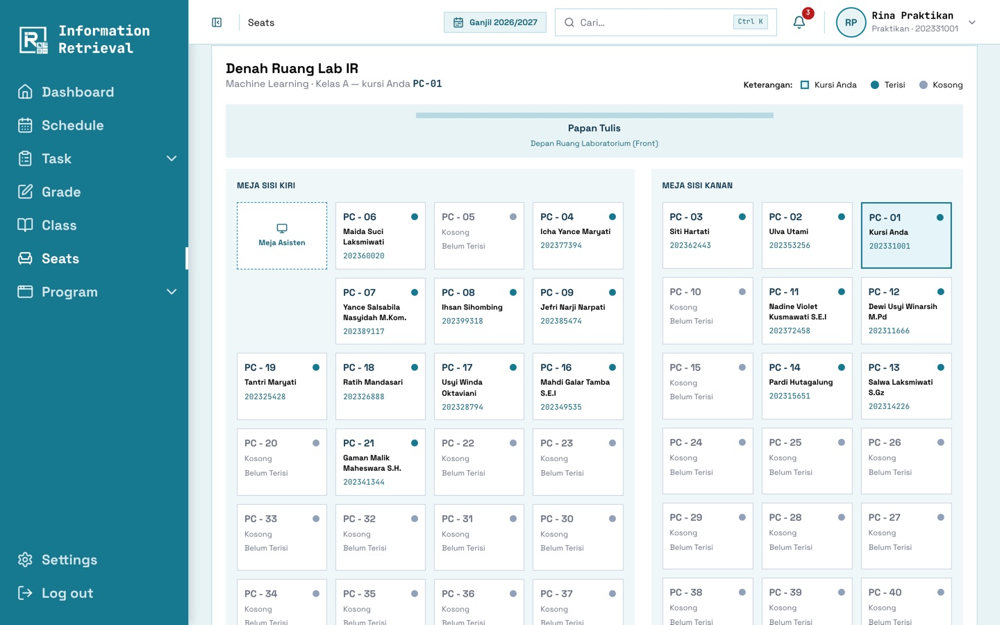

<div align="center">

# IR Lab Management System

**Sistem informasi berbasis web untuk mendigitalisasi praktikum, penilaian, dan kegiatan asisten
di Laboratorium Information Retrieval ITPLN.**


<br>
[](https://github.com/RamaDinantiar/irlab-management-system/actions/workflows/tests.yml)


</div>

---

## Masalah yang diselesaikan

Sebelumnya tugas praktikum dikumpulkan lewat email, Google Form, dan drive yang terpisah. Nilai direkap
manual di spreadsheet, laporan mengawas ditulis di kertas, dan tukar shift diatur lewat grup chat.
Akibatnya data tercecer, rekap terlambat, dan audit akhir semester sulit dilakukan.

**IR Lab Management System memusatkan semuanya dalam satu aplikasi.** Kelas, jadwal, presensi, tugas,
penilaian, kontrak kursi, laporan mengawas, dan rekap bulanan tercatat per semester. Semuanya dapat
dilacak dan diaudit.

## Tampilan

<table>
  <tr>
    <td width="50%"><br><sub><b>Split-Screen Grade</b>: PDF jawaban di kiri, form nilai &amp; feedback di kanan.</sub></td>
    <td width="50%"><br><sub><b>Kontrak Tempat Duduk</b>: pilih kursi dari denah lab, berlaku satu semester.</sub></td>
  </tr>
  <tr>
    <td><br><sub><b>Dashboard Asisten</b>: sesi berjalan, antrean penilaian, dan jadwal minggu ini.</sub></td>
    <td><br><sub><b>Dashboard Admin</b>: persetujuan, kepatuhan laporan, dan aktivitas terbaru.</sub></td>
  </tr>
  <tr>
    <td><br><sub><b>Laporan Mengawas</b>: diisi dari jadwal shift, diverifikasi Sekretaris/Bendahara.</sub></td>
    <td><br><sub><b>Editor Denah</b>: atur kursi, meja asisten, dan lorong ruang lab.</sub></td>
  </tr>
</table>

Galeri lengkap per peran ada di [panduan pengguna](docs/09-user-guide/).

## Fitur utama

<table>
<tr>
<th width="33%">🎓 Praktikan</th>
<th width="33%">🧑‍🏫 Asisten</th>
<th width="33%">🛠️ Admin</th>
</tr>
<tr valign="top">
<td>

- Gabung kelas dengan **token**
- **Jadwal** mingguan & sesi yang sedang berjalan
- Kerjakan **Pre/Post-Test** & kumpulkan **laporan** (PDF/ZIP) dengan nomor tanda terima
- Lihat **nilai & feedback** per pertemuan
- Pilih **kursi** dari denah lab
- Notifikasi tenggat H-1

</td>
<td>

- **Sesi kelas otomatis** sesuai jam + checklist presensi
- Buat tugas dengan editor teks kaya & blok kode
- **Split-Screen Grade** (PDF.js & penjelajah ZIP), simpan batch, publikasi nilai
- **Laporan mengawas** + verifikasi oleh Sekretaris/Bendahara
- **Generate** rekap bulanan (Word ZIP & Excel) dan honor
- Jadwal shift & **tukar shift**

</td>
<td>

- Kelola **semester**, termasuk salin struktur ke semester baru
- Mata kuliah (bobot nilai), kelas & jadwal, **persetujuan** usulan asisten
- **Editor denah** ruang lab & koreksi kontrak kursi
- Pengguna: tambah, **impor CSV/Excel**, reset password
- **Audit log** & pengaturan sistem
- Pengumuman global terjadwal

</td>
</tr>
</table>

## Tech stack

| Lapisan   | Teknologi                                                                                   |
| --------- | ------------------------------------------------------------------------------------------- |
| Back-end  | Laravel 13 (PHP 8.4+), Fortify (autentikasi), antrean & cache berbasis database             |
| Front-end | React 19 + Inertia 3, TypeScript, Tailwind CSS 4, Radix UI, Wayfinder (route bertipe)       |
| Database  | MySQL 8 (SQLite in-memory untuk test)                                                       |
| Dokumen   | PhpWord (laporan Word), OpenSpout (Excel/CSV), PDF.js (pratinjau PDF), TipTap (editor soal) |
| Kualitas  | PHPUnit (299 test), PHPStan/Larastan level 7, Pint, Vite+ lint & format, GitHub Actions     |

## Quick start

Butuh PHP 8.4+, Composer 2, Node.js 20+, dan MySQL 8 dengan database `ir_lab` yang sudah dibuat
(lihat [instalasi](docs/07-installation.md)).

```bash
composer install && npm ci
cp .env.example .env && chmod 600 .env    # isi DB_PASSWORD
php artisan key:generate
php artisan migrate --seed                # skema + data demo (hanya APP_ENV=local)
php artisan storage:link
composer dev                              # server, queue, scheduler, log, Vite
```

Buka http://127.0.0.1:8000.

### Akun demo

> Khusus lingkungan **lokal/demo**. Seeder demo menolak berjalan di produksi.

| Peran                          | Email                  | Password   |
| ------------------------------ | ---------------------- | ---------- |
| Admin                          | `admin@irlab.test`     | `password` |
| Asisten (Sekretaris/Bendahara) | `asisten@irlab.test`   | `password` |
| Praktikan                      | `praktikan@irlab.test` | `password` |

## Dokumentasi

|                                                        |                                                         |
| ------------------------------------------------------ | ------------------------------------------------------- |
| [01 · Gambaran umum](docs/01-overview.md)              | Visi, latar belakang, ruang lingkup                     |
| [02 · PRD](docs/02-prd.md)                             | Dokumen kebutuhan produk v2.0, sesuai aplikasi saat ini |
| [03 · Arsitektur](docs/03-architecture.md)             | Diagram, alur request, antrean, penyimpanan file        |
| [04 · Database](docs/04-database.md)                   | ERD & penjelasan tabel utama                            |
| [05 · Peran & hak akses](docs/05-roles-permissions.md) | Matriks RBAC, jabatan Sekretaris/Bendahara              |
| [06 · Fitur](docs/06-features/)                        | Satu dokumen per modul                                  |
| [07 · Instalasi](docs/07-installation.md)              | Instalasi lokal & troubleshooting                       |
| [08 · Deployment](docs/08-deployment.md)               | Produksi, Supervisor, cron, backup, darurat             |
| [09 · Panduan pengguna](docs/09-user-guide/)           | Cara pakai per peran, dengan screenshot                 |
| [10 · Keamanan](docs/10-security.md)                   | File, sesi, password, audit log                         |
| [CHANGELOG](CHANGELOG.md)                              | Riwayat versi                                           |

## Tim & kredit

|                     |                                                            |
| ------------------- | ---------------------------------------------------------- |
| Pengembang          | Rama Dinantiar (202331044, S1 Teknik Informatika)          |
| Pembimbing lapangan | Dine Tiara Kusuma, S.T., M.Kom, Kepala Lab IR ITPLN        |
| Dosen pembimbing    | Andi Dahroni, S.T., M.Kom                                  |
| Mitra               | Laboratorium Information Retrieval, Institut Teknologi PLN |
| Periode             | Program magang Oktober – Desember 2026                     |

## Lisensi

Hak cipta © 2026 Rama Dinantiar dan IR Lab ITPLN. **Bukan perangkat lunak open source.**
Lihat Rama Dinantiar Rama Dinantiar.
