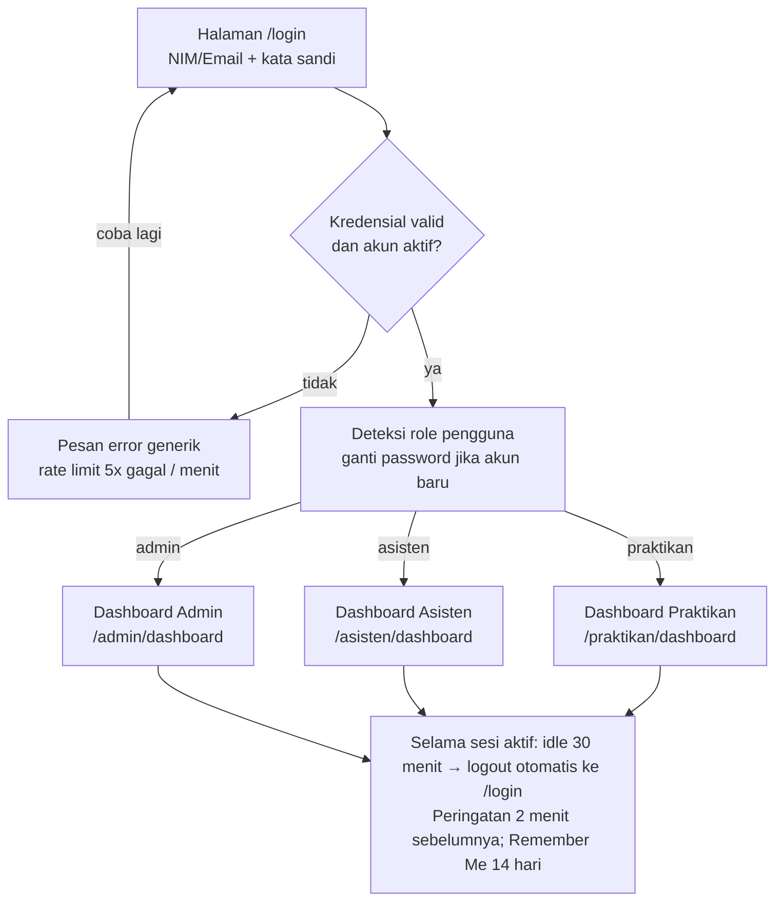

# PRD — Information Retrieval Laboratory (IR Lab) Management System

[← Kembali ke README](../README.md)

**Versi:** v2.0, disesuaikan dengan aplikasi yang sudah dibangun · **Tanggal:** 21 Oktober 2026

| Versi | Tanggal         | Keterangan                                                                                                                                                                                                  |
| ----- | --------------- | ----------------------------------------------------------------------------------------------------------------------------------------------------------------------------------------------------------- |
| v1.0  | 4 Oktober 2026  | Draft awal untuk review tim                                                                                                                                                                                 |
| v2.0  | 21 Oktober 2026 | Diperbarui sesuai implementasi: topik pertemuan menggantikan modul, reset password OTP, registrasi mandiri, sesi kelas otomatis, satu jabatan Sekretaris/Bendahara, Program ditutup sementara, stack aktual |

**Penanda status:** ⏸ = sudah dibangun tetapi ditutup sementara · ⏳ = belum diterapkan (rencana). Requirement tanpa penanda sudah berjalan di aplikasi.

---

## 0. Ringkasan & Ruang Lingkup

IR Lab Management System adalah aplikasi web internal (Laravel + React) yang menggantikan proses manual lab: pendaftaran kelas, jadwal, tugas, penilaian, laporan mengawas, kontrak tempat duduk, dan program lab. Dokumen ini adalah acuan tunggal bagi tim Front-end, Back-end, QA, dan Product untuk rilis MVP.

**Dalam cakupan:** halaman Login, registrasi mandiri Praktikan, pemulihan akun (OTP), seluruh Dashboard internal untuk 3 peran (Praktikan, Asisten Lab, Admin), serta route dan database pendukungnya.

**Di luar cakupan:** Landing Page publik (sudah dikerjakan terpisah), aplikasi mobile native, dan fitur pada Bagian 9.

### Asumsi yang dipakai

| #   | Asumsi                                                                                                                                                                                                         | Dampak jika salah                                  |
| --- | -------------------------------------------------------------------------------------------------------------------------------------------------------------------------------------------------------------- | -------------------------------------------------- |
| A1  | Akun Praktikan dibuat lewat import CSV/Excel oleh Admin/Asisten (NIM, nama, email, jurusan) **atau registrasi mandiri** dengan email kampus (@itpln.ac.id) + verifikasi email. Registrasi dapat ditutup Admin. | Bila registrasi ditutup, semua akun lewat import.  |
| A2  | Pre-test & Post-test di MVP berbentuk soal esai/upload file (dinilai manual), **dikonfirmasi 4 Okt 2026**. Pilihan ganda auto-grading masuk fase berikutnya.                                                   | Perlu engine kuis, bank soal, timer, auto-scoring. |
| A3  | "Maintenance" adalah program lab internal (perawatan PC/perangkat) yang dikelola Asisten dan dicatat sebagai jenis Program, tidak dibuka untuk pendaftaran Praktikan.                                          | Perlu modul inventaris & tiket kerusakan.          |
| A4  | Lab saat ini memiliki **satu ruang** (Lab IR) dengan denah kursi tetap (grid baris × kolom) yang diatur Admin; struktur data mendukung banyak ruang. Kursi dikontrak per Kelas, bukan per pertemuan.           | Perlu pemilihan kursi per sesi.                    |
| A5  | Tukar shift: asisten tujuan harus menyetujui, Admin hanya menerima notifikasi (tanpa approval kedua).                                                                                                          | Perlu alur approval 2 tingkat.                     |
| A6  | Nilai akhir per mata kuliah = rata-rata berbobot komponen (Pre-test, Post-test, Laporan). Bobot diatur per Mata Kuliah oleh Admin.                                                                             | Perlu rumus penilaian khusus.                      |
| A7  | Batas idle sesi 30 menit (tidak berlaku untuk sesi Remember Me); Remember Me berlaku 14 hari.                                                                                                                  | Ubah di Pengaturan Sistem / `.env`.                |
| A8  | Notifikasi: in-app (lonceng) + email untuk kode OTP reset password, password sementara, verifikasi email, dan deadline H-1.                                                                                    | Perlu integrasi WhatsApp/Telegram.                 |

### Keputusan hasil klarifikasi (4 Okt 2026)

| Pertanyaan                                                         | Keputusan                                                | Bagian terdampak                      |
| ------------------------------------------------------------------ | -------------------------------------------------------- | ------------------------------------- |
| Apakah Asisten boleh membuat Mata Kuliah/Kelas sendiri?            | Boleh, tetapi **wajib disetujui Admin**.                 | Bagian 2, US-A01, FR-AS-02, FR-ADM-03 |
| Apakah ada peran yang menyetujui laporan mengawas sebelum direkap? | Ya, oleh **Sekretaris dan Bendahara** (jabatan Asisten). | Bagian 2, FR-AR-05, FR-AGN-03         |
| Apakah honor asisten dihitung dari laporan mengawas?               | Ya, **masuk MVP**.                                       | FR-AGN-03, FR-ADM-10                  |
| Apakah nilai dikirim ke SIAKAD?                                    | **Tidak**; nilai hanya disimpan di arsip lab.            | Bagian 9                              |
| Perkiraan jumlah pengguna aktif per semester?                      | **± 200 pengguna**.                                      | NFR 8.3                               |
| Apakah pelamar Rekrutmen wajib memiliki akun Praktikan?            | **Wajib** memiliki akun Praktikan.                       | FR-APR-03                             |

### Keputusan selama pengembangan (5–21 Okt 2026)

| Topik               | Keputusan                                                                                                              | Bagian terdampak        |
| ------------------- | ---------------------------------------------------------------------------------------------------------------------- | ----------------------- |
| Modul praktikum     | **Tidak ada unggah modul.** Setiap pertemuan cukup memiliki **topik**.                                                 | 2, FR-PS, FR-AC-04, 6.1 |
| Lupa password       | **Kode OTP 6 digit** ke email kampus, bukan tautan reset.                                                              | FR-AUTH-04              |
| Registrasi          | Registrasi mandiri khusus email kampus, dapat dibuka/ditutup Admin.                                                    | A1, FR-AUTH-10          |
| Jabatan asisten     | Sekretaris dan Bendahara digabung menjadi **satu jabatan Sekretaris/Bendahara**.                                       | 2, FR-AR-05, FR-AGN-03  |
| Sesi kelas          | Sesi **mulai & selesai otomatis** sesuai jam kelas; asisten dapat mengakhiri lebih awal.                               | FR-AD-01                |
| Pre-Test            | Mode **Sesi Berjalan**: terbuka otomatis saat sesi dimulai, berdurasi N menit.                                         | FR-PT-06                |
| Laporan mengawas    | Jumlah hadir & kondisi lab dihapus; **foto dokumentasi wajib**; tim asisten jaga.                                      | US-A03, FR-AR           |
| Dokumen rekap       | **Word (.docx)** dari template, bukan PDF.                                                                             | US-A04, FR-AGN          |
| Program             | Sudah dibangun, **ditutup sementara** (`LAB_PROGRAMS_ENABLED=false`).                                                  | 5.3, 5.4                |
| Akun Admin produksi | Admin tetap lewat `AdminSeeder`; Admin aktif terakhir tidak bisa dinonaktifkan; pemulihan darurat `lab:recover-admin`. | FR-AUTH-12, FR-ADM-07   |
| Tampilan            | Mengikuti Figma: sudut tajam (radius 0), palet teal Figma.                                                             | 7                       |

---

## 1. Product Vision & Objectives

**Visi:** Menjadikan IR Lab laboratorium yang 100% paperless, di mana setiap praktikum, penilaian, dan kegiatan asisten tercatat, terlacak, dan dapat diaudit dalam satu sistem.

**Problem statement:** Saat ini tugas dikumpulkan lewat kanal terpisah (email, Google Form, drive), nilai direkap manual di spreadsheet, laporan mengawas ditulis di kertas, dan pendaftaran program diumumkan lewat grup chat. Akibatnya terjadi data tercecer, keterlambatan rekap, dan sulitnya audit akhir semester.

### Objectives

1. **Sentralisasi akademik:** seluruh pengumpulan tugas dan penilaian praktikum terjadi di dalam sistem.
2. **Efisiensi asisten:** memangkas waktu koreksi dan pembuatan laporan melalui Inline Grading, Split-Screen Review, dan rekap otomatis.
3. **Transparansi praktikan:** praktikan selalu tahu jadwal, tenggat, nilai, dan feedback secara real-time.
4. **Administrasi berbasis semester:** data terstruktur per semester sehingga pergantian semester tidak membutuhkan input ulang manual.

### KPI (diukur 1 semester setelah go-live)

| KPI                                                       | Baseline (estimasi) | Target                  | Cara ukur                                             |
| --------------------------------------------------------- | ------------------- | ----------------------- | ----------------------------------------------------- |
| Tugas yang dikumpulkan via sistem                         | 0%                  | ≥ 95%                   | Jumlah submission sistem ÷ total tugas yang diberikan |
| Median waktu dari submit hingga nilai terbit              | ± 7 hari            | ≤ 3 hari                | `graded_at − submitted_at` per submission             |
| Waktu menyusun rekap laporan mengawas bulanan             | ± 3 jam/asisten     | ≤ 5 menit               | Waktu proses Generate + survei asisten                |
| Laporan mengawas tercatat tepat hari yang sama            | n/a (kertas)        | ≥ 90%                   | `created_at` laporan pada tanggal shift               |
| Praktikan aktif mingguan (login ≥ 1×/minggu)              | 0%                  | ≥ 85%                   | Log sesi unik per minggu                              |
| Kesalahan kontrak tempat duduk yang perlu dikoreksi Admin | n/a                 | ≤ 2% dari total kontrak | Jumlah edit kontrak oleh Admin                        |
| Kepuasan pengguna (CSAT)                                  | n/a                 | ≥ 4,0 / 5               | Survei in-app akhir semester                          |
| Ketersediaan sistem saat jam praktikum                    | n/a                 | ≥ 99,5%                 | Uptime monitoring                                     |

Baseline bertanda estimasi perlu divalidasi lewat wawancara singkat dengan 3–5 asisten sebelum go-live.

---

## 2. User Personas & Role-Based Access Control

Sistem memakai tiga peran tetap. Asisten dapat diberi jabatan tambahan **Sekretaris/Bendahara** (satu jabatan, diatur Admin) yang membuka hak verifikasi laporan ngawas dan persetujuan rekap honor; jabatan bukan peran baru. Satu akun hanya memiliki satu peran aktif; seorang Asisten yang juga mengambil praktikum lain dibuatkan peran Asisten dengan akses "mode Praktikan" (lihat Bagian 9 untuk multi-role penuh).

| Persona                                           | Profil                                                | Tujuan utama                                                       | Frustrasi saat ini                                                     | Perangkat dominan |
| ------------------------------------------------- | ----------------------------------------------------- | ------------------------------------------------------------------ | ---------------------------------------------------------------------- | ----------------- |
| **Praktikan** (mis. "Rina", mahasiswa semester 4) | Mengikuti 1–3 kelas praktikum per semester            | Tahu jadwal, kumpulkan tugas tepat waktu, lihat nilai dan feedback | Info tersebar di grup chat, tidak tahu tugas sudah diterima atau belum | Mobile (± 70%)    |
| **Asisten Lab** (mis. "Dimas", semester 6)        | Mengampu 2–4 kelas, punya 2–6 shift ngawas per minggu | Menilai cepat, laporan ngawas tidak makan waktu, jadwal jelas      | Rekap nilai & laporan manual, tukar shift lewat chat tanpa jejak       | Desktop/laptop    |
| **Admin** (Koordinator/Kepala Lab)                | Mengelola semester, master data, dan kebijakan lab    | Data rapi per semester, kontrol penuh, audit mudah                 | Data semester lama bercampur, sulit koreksi kesalahan                  | Desktop           |

### Matriks hak akses

Keterangan: **C** = Create, **R** = Read, **U** = Update, **D** = Delete/Arsip, **—** = tidak ada akses, **Own** = hanya data milik sendiri, **Ampu** = hanya kelas/mata kuliah yang diampu.

| Modul / Resource                                        | Praktikan                     | Asisten Lab                                                    | Admin                           |
| ------------------------------------------------------- | ----------------------------- | -------------------------------------------------------------- | ------------------------------- |
| Semester (buat, aktifkan, arsip)                        | —                             | R                                                              | CRUD                            |
| Mata Kuliah & bobot nilai                               | R (yang diikuti)              | R, ajukan baru (perlu persetujuan Admin)                       | CRUD                            |
| Kelas & Jadwal                                          | R (Own)                       | CRU (Ampu); kelas baru perlu persetujuan Admin                 | CRUD                            |
| Token kelas & Lock Class                                | Gabung via token              | CRU (Ampu)                                                     | CRUD                            |
| Data Praktikan di kelas                                 | R teman sekelas (nama, NIM)   | R, keluarkan dari kelas (Ampu)                                 | CRUD                            |
| Pertemuan & topik                                       | R                             | CRU (Ampu)                                                     | CRUD                            |
| Task (Pre/Post-test, Laporan)                           | R, submit (Own)               | CRUD (Ampu)                                                    | CRUD                            |
| Grade & feedback                                        | R (Own)                       | CRU (Ampu)                                                     | CRUD                            |
| Seats / kontrak tempat duduk                            | C, R denah kelas yang diikuti | R (Ampu)                                                       | CRUD, ubah kontrak              |
| Denah ruang lab                                         | R                             | R                                                              | CRUD                            |
| Laporan mengawas                                        | —                             | CRU (Own); Sekretaris/Bendahara: verifikasi semua              | R semua, verifikasi, buka kunci |
| Generate rekap                                          | —                             | Own; Sekretaris/Bendahara: semua asisten & setujui rekap honor | Semua asisten                   |
| Tukar shift                                             | —                             | Ajukan & setujui (Own)                                         | R, override                     |
| Program (Workshop, Quick Tutor, Rekrutmen, Maintenance) | R, daftar                     | CRUD                                                           | CRUD                            |
| Pengumuman                                              | R                             | C (Ampu)                                                       | CRUD (global)                   |
| Manajemen pengguna & import                             | —                             | Import praktikan ke kelas Ampu                                 | CRUD semua akun                 |
| Audit log                                               | —                             | —                                                              | R                               |

Pemeriksaan akses dilakukan di Back-end pada setiap request: middleware peran (`role:`), akun aktif, wajib ganti password, lalu pengecekan kepemilikan di controller/action (mis. kelas yang diampu). Front-end hanya menyembunyikan menu, tidak menjadi lapisan keamanan.

---

## 3. User Stories & Acceptance Criteria

Prioritas memakai MoSCoW. Semua story berlabel **Must** wajib lulus QA sebelum go-live. Acceptance criteria ditulis dalam format Given / When / Then agar bisa langsung dijadikan test case.

### 3.1 Praktikan

**US-P01 — Gabung kelas dengan token (Must)**
Sebagai Praktikan, saya ingin bergabung ke kelas praktikum dengan memasukkan kode token, agar saya otomatis mendapat jadwal, tugas, dan nilai kelas tersebut.

1. Given saya di Dashboard, When saya klik "Gabung Kelas", Then muncul modal berisi input 6 karakter alfanumerik (huruf besar, tanpa O/0/I/1 untuk menghindari salah baca).
2. Given token valid, kelas tidak terkunci, dan kuota belum penuh, When saya klik "Gabung", Then saya terdaftar, muncul toast sukses, dan kelas tampil di Dashboard dan Schedule tanpa reload.
3. Given token salah atau kedaluwarsa, Then muncul pesan "Kode kelas tidak ditemukan" tanpa mengungkap detail kelas lain.
4. Given kelas dikunci atau kuota penuh, Then muncul pesan "Kelas sudah ditutup, hubungi asisten".
5. Given saya sudah terdaftar di kelas itu, Then muncul pesan "Anda sudah tergabung di kelas ini".
6. Given saya sudah terdaftar di kelas lain dengan Mata Kuliah yang sama pada semester aktif, Then sistem menolak pendaftaran ganda.
7. Percobaan token salah dibatasi 5 kali per 10 menit per akun (rate limit).

**US-P02 — Mengumpulkan tugas (Must)**
Sebagai Praktikan, saya ingin mengunggah jawaban Pre-test, Post-test, atau Laporan, agar tugas saya tercatat dan bisa dinilai.

1. Given tugas berstatus terbuka, When saya membuka detail tugas, Then saya melihat soal (rich text dan blok kode dengan font JetBrains Mono), lampiran soal, tenggat, dan sisa waktu (countdown).
2. When saya mengunggah file, Then hanya PDF (≤ 10 MB), ZIP (≤ 20 MB), atau gambar JPG/PNG (≤ 5 MB) yang diterima sesuai pengaturan tugas, dan saya dapat mengisi text-field jawaban (tidak ada/opsional/wajib sesuai pengaturan).
3. When saya klik "Kumpulkan", Then muncul konfirmasi, lalu status berubah menjadi "Terkumpul" dengan stempel waktu server.
4. Given tenggat belum lewat, Then saya dapat mengganti submission; versi sebelumnya tersimpan sebagai riwayat dan hanya versi terakhir yang dinilai.
5. Given tenggat lewat dan tugas mengizinkan terlambat, Then submission diberi label merah "Terlambat" beserta durasi keterlambatan. Jika tidak diizinkan, tombol "Kumpulkan" nonaktif.
6. Given koneksi putus saat upload, Then muncul pesan error dan tombol coba lagi; tidak ada submission setengah jadi yang tersimpan.
7. Setiap kiriman mendapat **nomor tanda terima** (mis. `IRL-261021-000123`).
8. Pre-Test hanya terbuka selama sesi kelas berjalan (lihat FR-PT-06) dan dapat dikerjakan langsung dari panel _Kelas Sedang Berlangsung_ di Dashboard.

**US-P03 — Membaca nilai dan feedback (Must)**
Sebagai Praktikan, saya ingin melihat nilai dan catatan revisi dari asisten, agar saya tahu letak kesalahan kode atau algoritma saya.

1. Given nilai sudah dipublikasikan asisten, Then baris tugas di menu Grade menampilkan nilai, status "Dinilai" (hijau), nama asisten penilai, dan tanggal.
2. When saya klik baris tersebut, Then pop-up menampilkan feedback lengkap, termasuk blok kode dengan syntax highlight.
3. Given nilai belum dipublikasikan, Then status tampil "Menunggu Penilaian" (kuning) tanpa angka.
4. Halaman Grade bersifat read-only; tidak ada aksi edit dari sisi Praktikan.
5. Ringkasan per mata kuliah menampilkan nilai akhir sementara sesuai bobot (A6).

**US-P04 — Kontrak tempat duduk (Must)**
Sebagai Praktikan, saya ingin memilih kursi di denah lab untuk kelas yang saya ikuti, agar posisi saya tetap selama semester.

1. Given saya terdaftar di kelas yang kontrak kursinya dibuka, When saya membuka Seats dan memilih kelas, Then denah lab tampil dengan status kursi: tersedia (putih), terisi (abu-abu + nama dan NIM teman), milik saya (primary).
2. When saya memilih kursi kosong, Then form konfirmasi menampilkan Nama, NIM, Kelas, dan Jurusan yang terisi otomatis dari profil (tidak dapat diubah), lalu saya klik "Kontrak Kursi".
3. Given dua praktikan memilih kursi yang sama hampir bersamaan, Then hanya yang pertama tersimpan; yang kedua mendapat pesan "Kursi baru saja diambil" dan denah diperbarui.
4. Given saya terdaftar di ≥ 2 kelas, Then saya bisa berpindah tab antar kelas dan melihat kursi saya di masing-masing kelas.
5. Setelah kontrak tersimpan, Praktikan tidak dapat mengubahnya sendiri; perubahan hanya oleh Admin.

### 3.2 Asisten Lab

**US-A01 — Membuat kelas dan token (Must)**
Sebagai Asisten, saya ingin membuat jadwal kelas dan mendapatkan token 6 karakter, agar praktikan bisa bergabung sendiri.

1. When saya menyimpan kelas baru (Mata Kuliah yang saya ampu, nama kelas, hari, jam, ruang, kuota), Then kelas berstatus "Menunggu Persetujuan" dan Admin menerima notifikasi. Setelah Admin menyetujui, sistem men-generate token unik 6 karakter dan menampilkannya dengan tombol salin. Jika ditolak, saya menerima alasan penolakan dan dapat merevisi lalu mengajukan ulang.
2. Token unik di antara kelas pada semester aktif.
3. Saya dapat me-regenerate token; token lama langsung tidak berlaku.
4. Saya dapat mengaktifkan "Lock Class"; Praktikan baru tidak dapat bergabung, anggota lama tidak terpengaruh.
5. Ketika jumlah anggota = kuota, kelas terkunci otomatis dan saya menerima notifikasi.

**US-A02 — Menilai cepat dengan Split-Screen (Must)**
Sebagai Asisten, saya ingin membaca file tugas dan mengisi nilai di layar yang sama, agar penilaian satu kelas bisa selesai dalam satu sesi.

1. Given saya membuka Grade → pilih kelas → pilih tugas, Then tabel menampilkan semua praktikan dengan status submission (Terkumpul, Terlambat, Belum Mengumpulkan).
2. When saya mengetik nilai (0–100) dan feedback langsung di baris tabel, Then baris yang berubah ditandai (dirty state) dan tombol "Simpan Batch (n)" aktif.
3. When saya klik "Simpan Batch", Then semua perubahan tersimpan dalam satu transaksi; jika ada baris invalid, tidak ada yang tersimpan dan baris invalid disorot merah.
4. When saya membuka "Split-Screen Mode", Then panel kiri (70%) menampilkan PDF viewer atau Code Viewer untuk isi ZIP, panel kanan (30%) form nilai dan feedback; tombol Prev/Next dan shortcut keyboard (J/K) berpindah antar praktikan.
5. Nilai berstatus Draft sampai saya klik "Publikasikan"; hanya nilai yang dipublikasikan yang terlihat oleh Praktikan.
6. Meninggalkan halaman dengan perubahan belum tersimpan memunculkan peringatan.

**US-A03 — Laporan mengawas (Must)**
Sebagai Asisten, saya ingin mengisi berita acara shift lewat form singkat, agar kehadiran dan kejadian di lab tercatat.

1. When saya klik "Buat Laporan" (dari Dashboard atau menu Report), Then form terbuka dengan tanggal, shift, dan kelas terisi otomatis dari jadwal saya hari itu (atau shift kemarin yang belum dilaporkan); materi terisi dari topik pertemuan.
2. Field wajib: jam mulai, jam selesai, kelas/kegiatan, materi, deskripsi kegiatan (≥ 10 karakter), tim asisten jaga (1–4 orang, penanggung jawab pertama), dan **foto dokumentasi** (JPG/PNG ≤ 5 MB).
3. Daftar laporan ditampilkan sebagai Daily Accordion yang dikelompokkan per tanggal, terbaru di atas.
4. Laporan dapat diedit hingga H+1 pukul 23.59; setelah itu terkunci dan hanya Admin yang bisa membuka kunci.

**US-A04 — Rekap bulanan (Must)**
Sebagai Asisten, saya ingin mengekspor rekap laporan satu bulan, agar saya tidak menyusun dokumen manual.

1. When saya memilih bulan dan format (ZIP berisi dokumen Word per hari, atau Excel), Then sistem memproses ekspor di background queue dan menampilkan progres. Dokumen Word untuk satu hari tertentu dapat diunduh langsung tanpa antrean.
2. Ketika selesai, Then saya mendapat notifikasi dan tautan unduh yang berlaku 24 jam.
3. Dokumen harian (.docx) dibuat dari template `resources/templates/laporan-mengawas.docx` sesuai tata letak berita acara lab (kop, tabel, kolom tanda tangan).
4. Bulan tanpa laporan menghasilkan pesan "Tidak ada laporan pada periode ini", bukan file kosong.

**US-A05 — Tukar shift (Should)**
Sebagai Asisten, saya ingin mengajukan tukar shift ke asisten lain, agar perubahan jadwal tercatat resmi.

1. When saya memilih shift saya dan asisten tujuan, lalu mengirim alasan, Then asisten tujuan menerima notifikasi.
2. When asisten tujuan menyetujui, Then jadwal kedua asisten diperbarui otomatis dan Admin menerima notifikasi (A5).
3. Pengajuan yang tidak direspons hingga 24 jam sebelum shift otomatis kedaluwarsa.

### 3.3 Admin

**US-D01 — Membuat semester baru (Must)**
Sebagai Admin, saya ingin membuat dan mengaktifkan semester baru, agar data semester lama tidak bercampur.

1. When saya membuat semester (mis. "Ganjil 2026/2027", tanggal mulai dan selesai), Then semester berstatus Draft.
2. When saya klik "Aktifkan", Then muncul konfirmasi berisi ringkasan dampak; setelah dikonfirmasi, hanya satu semester yang berstatus Aktif dan semester sebelumnya menjadi Arsip (read-only).
3. Saya dapat menyalin struktur (Mata Kuliah dan bobot nilai) dari semester sebelumnya tanpa data praktikan, submission, nilai, dan asisten pengampu; mata kuliah dengan kode yang sudah ada dilewati. Denah lab dipakai bersama antar semester. ⏳ Penyalinan template tugas belum diterapkan.
4. "Refresh data" mengarsipkan data, tidak menghapus permanen; penghapusan permanen hanya untuk data arsip berumur > 2 tahun dan memerlukan konfirmasi ketik ulang nama semester.

**US-D02 — Mengelola Mata Kuliah, Kelas, dan Jadwal (Must)**
Sebagai Admin, saya ingin mengatur Mata Kuliah, Kelas, Jadwal, dan asisten pengampu, agar operasional semester siap sebelum praktikum dimulai.

1. Saya dapat membuat Mata Kuliah (kode, nama, SKS, bobot Pre-test/Post-test/Laporan dengan total 100%).
2. Saya dapat membuat Kelas dan menugaskan satu atau lebih Asisten pengampu.
3. Sistem menolak jadwal yang bentrok pada ruang dan jam yang sama, dan memperingatkan jika asisten pengampu memiliki jadwal bentrok.
4. Saya dapat mengimpor data pengguna/praktikan dari CSV/Excel menggunakan template yang disediakan, dengan laporan baris gagal. ⏳ Impor jadwal kelas dari Excel belum diterapkan.

**US-D03 — Mengoreksi kontrak tempat duduk (Must)**
Sebagai Admin, saya ingin memindahkan atau membatalkan kontrak kursi praktikan, agar kesalahan bisa diperbaiki.

1. Given saya membuka denah suatu kelas, When saya klik kursi terisi, Then saya bisa memindahkan ke kursi kosong lain atau membatalkan kontrak.
2. Setiap perubahan wajib menyertakan alasan dan tercatat di audit log (siapa, kapan, sebelum, sesudah).
3. Praktikan terdampak menerima notifikasi in-app.

**US-D04 — Mengelola pengguna (Must)**
Sebagai Admin, saya ingin membuat, mengimpor, menonaktifkan akun, dan mengubah peran, agar hanya orang yang berhak yang bisa masuk.

1. Import CSV/Excel membuat akun dengan password sementara dan mengirim email berisi password tersebut.
2. Akun yang dinonaktifkan langsung kehilangan semua sesi aktif.
3. Perubahan peran dan jabatan (Sekretaris/Bendahara) tercatat di audit log.
4. Reset password oleh Admin membuat password sementara baru dan mengakhiri semua sesi akun tersebut.
5. Admin tidak dapat menonaktifkan/menurunkan dirinya sendiri, dan Admin aktif terakhir tidak dapat dinonaktifkan atau diturunkan perannya.

---

## 4. Sitemap / Information Architecture

Semua pengguna masuk lewat satu halaman `/login`, lalu diarahkan ke area peran masing-masing dengan prefix URL `/praktikan`, `/asisten`, atau `/admin`. Setiap area memakai layout yang sama (sidebar + topbar), hanya isi menunya yang berbeda.

### 4.1 Alur autentikasi & role-based routing

Login gagal selalu kembali ke `/login` dengan pesan generik; login berhasil membaca role di server lalu mengarahkan ke dashboard peran tersebut. Membuka URL milik peran lain menghasilkan 403.

### 4.2 Struktur menu per peran

| Peran       | Menu sidebar (urutan)                                                                                                                                                       | Prefix route   |
| ----------- | --------------------------------------------------------------------------------------------------------------------------------------------------------------------------- | -------------- |
| Praktikan   | Dashboard · Schedule · Task · Grade · Class · Seats · Program ⏸ · Settings                                                                                                  | `/praktikan/*` |
| Asisten Lab | Dashboard · Schedule · Class · Seats · Task · Grade · Report · Generate · Program ⏸ · Settings                                                                              | `/asisten/*`   |
| Admin       | Dashboard · Semester · Mata Kuliah · Kelas & Jadwal · Ruang & Denah · Kontrak Kursi · Pengguna · Pengumuman · Audit Log · Pengaturan, + seluruh menu Asisten (lintas kelas) | `/admin/*`     |

Contoh route detail: `/praktikan/tasks/{target}`, `/asisten/grading/{target}/review`, `/asisten/class/{id}`, `/asisten/sessions/{meeting}`, `/admin/rooms/{room}/layout`. Topbar berisi pemilih semester (info), pencarian global (Ctrl K), lonceng notifikasi, dan menu profil.

### 4.3 User flow kunci

**Praktikan — minggu pertama semester**

1. Login dengan NIM + password sementara (atau daftar mandiri dengan email kampus) → wajib ganti password bila akun dibuat Admin.
2. Dashboard kosong menampilkan panduan → klik "Gabung Kelas" → masukkan token dari asisten.
3. Buka Seats → pilih kelas → pilih kursi → konfirmasi kontrak.
4. Buka Schedule untuk melihat pertemuan dan topiknya.
5. Saat sesi: panel _Kelas Sedang Berlangsung_ di Dashboard → kerjakan Pre-test → submit → lihat tanda terima.
6. Beberapa hari kemudian: notifikasi "Nilai dipublikasikan" → Grade → baca feedback.

**Asisten — satu sesi praktikum**

1. Sesi dimulai otomatis sesuai jam kelas → panel _Sesi Berlangsung_ di Dashboard → buka sesi → isi presensi.
2. Pre-test otomatis terbuka saat sesi dimulai; Post-test/Laporan dibuat atau sudah terjadwal di Task.
3. Setelah sesi: modal "Buat Laporan Ngawas" (terisi otomatis) → simpan → ajukan untuk verifikasi.
4. Grade → pilih tugas → inline editing atau Split-Screen → Simpan Batch → Publikasikan.
5. Akhir bulan: Generate → pilih bulan dan format → unduh ZIP/Excel.

**Admin — pergantian semester**

1. Semester → buat semester baru → salin struktur dari semester lalu.
2. Atur Mata Kuliah, bobot, asisten pengampu, Kelas & Jadwal (atau import Excel); setujui pengajuan Mata Kuliah/Kelas dari Asisten.
3. Import akun praktikan baru → aktifkan semester → semester lama otomatis menjadi arsip.

---

## 5. Functional Requirements

Setiap requirement diberi ID (FR-xx) untuk ditautkan ke tiket dan test case.

### 5.1 Autentikasi & Sesi (FR-AUTH)

| ID         | Requirement                                                                                                                                                                                                                                                                                   | Catatan teknis                                                                                                                                                                     |
| ---------- | --------------------------------------------------------------------------------------------------------------------------------------------------------------------------------------------------------------------------------------------------------------------------------------------- | ---------------------------------------------------------------------------------------------------------------------------------------------------------------------------------- |
| FR-AUTH-01 | Satu halaman login `/login` untuk semua peran, field "NIM atau Email" dan "Kata Sandi".                                                                                                                                                                                                       | BE: deteksi input mengandung `@` → cari di kolom `email`, selain itu di kolom `nim`. Pesan error selalu generik: "NIM/Email atau kata sandi salah".                                |
| FR-AUTH-02 | Role-based routing setelah login: Praktikan → `/praktikan/dashboard`, Asisten → `/asisten/dashboard`, Admin → `/admin/dashboard`.                                                                                                                                                             | BE mengembalikan `role` dan `redirect_to`; middleware `role:` pada setiap grup route. Akses URL peran lain → 403 dengan halaman ramah.                                             |
| FR-AUTH-03 | Remember Me menyimpan sesi 14 hari.                                                                                                                                                                                                                                                           | Laravel `remember_token`, cookie `HttpOnly`, `Secure`, `SameSite=Lax`.                                                                                                             |
| FR-AUTH-04 | Forgot Password: input email kampus → **kode OTP 6 digit** dikirim ke email → verifikasi kode → buat password baru. Kode berlaku 10 menit, maks. 5 kali percobaan, kirim ulang setelah 60 detik; kode lama otomatis tidak berlaku. Email yang belum terdaftar diberi pesan "belum terdaftar". | Tabel `password_reset_codes` (kode di-hash). Rate limit per email+IP dan per IP. Setelah berhasil, semua sesi akun diakhiri.                                                       |
| FR-AUTH-05 | Kebijakan password: minimal 8 karakter, kombinasi huruf dan angka; wajib ganti saat login pertama (akun hasil import).                                                                                                                                                                        | Validasi `Password::min(8)->letters()->numbers()`. Flag `must_change_password`.                                                                                                    |
| FR-AUTH-06 | Auto-logout setelah idle 30 menit (dapat diatur Admin); peringatan modal 2 menit sebelumnya dengan tombol "Tetap Masuk". Tidak berlaku untuk sesi Remember Me.                                                                                                                                | FE: timer aktivitas (mouse, keyboard, touch) + sinkron antar tab via `BroadcastChannel`; `POST /session/keep-alive`. BE: `SESSION_LIFETIME=30`.                                    |
| FR-AUTH-07 | Rate limit login: 5 kali percobaan per menit per kombinasi akun + IP.                                                                                                                                                                                                                         | `RateLimiter` Laravel (Fortify).                                                                                                                                                   |
| FR-AUTH-08 | Logout manual dari menu profil menghapus sesi server.                                                                                                                                                                                                                                         | Invalidate session + regenerate CSRF token.                                                                                                                                        |
| FR-AUTH-09 | Admin dapat menonaktifkan akun; semua sesi akun tersebut langsung berakhir.                                                                                                                                                                                                                   | Session driver `database` agar sesi dapat dihapus per user; token Remember Me diganti.                                                                                             |
| FR-AUTH-10 | Registrasi mandiri Praktikan: NIM, nama, jurusan (dropdown S1 TI / S1 SI), angkatan, email kampus, telepon, password; wajib verifikasi email. Dapat ditutup Admin.                                                                                                                            | Domain email dari Pengaturan Sistem (`registration_domains`), dicocokkan persis setelah `@` terakhir.                                                                              |
| FR-AUTH-11 | Ganti password sendiri mengakhiri sesi di perangkat lain; sesi saat ini tetap masuk.                                                                                                                                                                                                          | `EndUserSessions::exceptCurrent`.                                                                                                                                                  |
| FR-AUTH-12 | Admin tetap untuk produksi dan pemulihan darurat.                                                                                                                                                                                                                                             | `db:seed --class=AdminSeeder` (password acak ditampilkan sekali, wajib ganti); `php artisan lab:recover-admin <email>` dari server; seeder demo ditolak di luar `local`/`testing`. |

### 5.2 Enrollment / Sistem Token Kelas (FR-ENR)

| ID        | Requirement                                                                                                                             | Catatan teknis                                                                                                                                                 |
| --------- | --------------------------------------------------------------------------------------------------------------------------------------- | -------------------------------------------------------------------------------------------------------------------------------------------------------------- |
| FR-ENR-01 | Token 6 karakter dari himpunan `ABCDEFGHJKLMNPQRSTUVWXYZ23456789`, unik per semester aktif. Token dibuat setelah kelas disetujui Admin. | Generate dengan `random_int`, retry jika bentrok; kolom `classes.join_token` UNIQUE bersama `semester_id`.                                                     |
| FR-ENR-02 | Praktikan bergabung via modal "Gabung Kelas".                                                                                           | `POST /praktikan/enrollments {token}` dalam DB transaction + `lockForUpdate()` pada baris kelas untuk menjaga kuota. Token salah dibatasi 5 kali per 10 menit. |
| FR-ENR-03 | Lock Class manual dan auto-lock saat kuota penuh.                                                                                       | Kolom `is_locked`, `quota`; auto-lock dihitung saat enrollment.                                                                                                |
| FR-ENR-04 | Asisten dapat mengeluarkan praktikan dari kelas (dengan alasan).                                                                        | Soft delete enrollment; submission tetap tersimpan.                                                                                                            |
| FR-ENR-05 | Satu praktikan tidak boleh berada di dua kelas dengan Mata Kuliah sama dalam satu semester.                                             | Validasi BE sebelum insert.                                                                                                                                    |

### 5.3 Modul Praktikan

**Dashboard (FR-PD)** — widget yang direkomendasikan, berurutan dari atas sesuai prioritas informasi:

1. **Kartu sapaan + tombol "Gabung Kelas"** (selalu terlihat).
2. **Kelas berikutnya:** mata kuliah, topik pertemuan, ruang, jam, asisten penanggung jawab, nomor kursi saya, dan hitung mundur.
   2a. **Kelas Sedang Berlangsung:** saat sesi berjalan, Pre/Post-Test yang dibuka asisten bisa langsung dikerjakan; diperbarui otomatis tiap 20 detik.
3. **Tugas terdekat:** maksimal 5 tugas dengan tenggat terdekat, badge status (Belum, Terkumpul, Terlambat) dan countdown; merah jika < 24 jam.
4. **Progres per mata kuliah:** jumlah tugas terkumpul ÷ total, dan nilai akhir sementara.
5. **Feedback terbaru:** 3 nilai terakhir yang dipublikasikan dengan cuplikan feedback.
6. **Pengumuman lab:** pengumuman global dan per kelas, pin di atas.
7. **Program terbuka** ⏸: Workshop, Quick Tutor, atau Rekrutmen yang sedang membuka pendaftaran.

Empty state: jika belum punya kelas, Dashboard menampilkan panduan 3 langkah (minta token ke asisten → Gabung Kelas → pilih kursi).

**Schedule (FR-PS)**

- FR-PS-01: Tampilan matriks mingguan (hari × jam) untuk kelas yang diikuti; tiap sel berisi mata kuliah, kelas, dan ruang dengan warna mata kuliah yang konsisten. Tersedia juga tampilan "Semua Jadwal Lab".
- FR-PS-02: Daftar pertemuan 1–n beserta **topik**, tanggal, dan asisten penanggung jawab. Di mobile, tampilan menyesuaikan lebar layar.
- FR-PS-03: _(Dihapus di v2.0: tidak ada unggah/unduh modul. Materi cukup berupa topik pertemuan.)_
- FR-PS-04: Perubahan jadwal (mis. tukar asisten) tercermin otomatis dan memicu notifikasi in-app.

**Task (FR-PT)**

- FR-PT-01: Daftar tugas dengan filter jenis (Pre-test, Post-test, Laporan Praktikum), kelas, dan status.
- FR-PT-02: Halaman detail: soal rich text, blok kode (JetBrains Mono + syntax highlight), lampiran soal, tenggat, status.
- FR-PT-03: Form jawaban: upload file (PDF/ZIP/gambar sesuai pengaturan tugas) + text-field jawaban (Markdown sederhana, mendukung blok kode). Pre-test dan Post-test berformat esai/upload (A2).
- FR-PT-04: Resubmit sebelum tenggat; riwayat versi tersimpan.
- FR-PT-05: Tanda terima: setelah submit, tampil nomor tanda terima, waktu server, nama file, dan ukuran.
- FR-PT-06: Pre-test mode **Sesi Berjalan**: terbuka otomatis saat sesi kelas dimulai dan berlaku N menit (`task_targets.window_minutes`); dibuka oleh listener `OpenScheduledPretests` pada event `MeetingStarted`.

**Grade (FR-PG)**

- FR-PG-01: Tabel read-only berisi tugas, jenis, nilai, status, penilai, tanggal; dikelompokkan per mata kuliah.
- FR-PG-02: Pop-up detail feedback dengan dukungan blok kode.
- FR-PG-03: Ringkasan nilai akhir sementara per mata kuliah berdasarkan bobot.
- FR-PG-04: Di mobile, tabel berubah menjadi daftar kartu.

**Seats (FR-PST)**

- FR-PST-01: Pilih kelas (tab jika ≥ 2 kelas) → denah grid ruang lab sesuai konfigurasi Admin (posisi meja asisten, pintu, lorong).
- FR-PST-02: Kursi terisi menampilkan nama + NIM teman saat hover/tap.
- FR-PST-03: Form kontrak: Nama, NIM, Kelas, Jurusan terisi otomatis dari profil dan kelas (read-only). Jika data profil kosong, praktikan diminta melengkapinya terlebih dahulu.
- FR-PST-04: Kontrak hanya bisa dilakukan saat periode kontrak dibuka asisten/admin.
- FR-PST-05: Konkurensi: constraint UNIQUE (`class_id`, `seat_id`) dan (`class_id`, `user_id`) di database.
- FR-PST-06: ⏳ Tombol "Unduh Kartu Kursi" (PDF kecil), opsional, belum diterapkan.

**Program (FR-PP)** ⏸ _ditutup sementara_

- FR-PP-01: Etalase kartu program terbuka (Workshop, Quick Tutor, Rekrutmen) dengan poster, kuota, tanggal, dan status pendaftaran.
- FR-PP-02: Pendaftaran sesuai form yang dibangun asisten (field dan dokumen wajib).
- FR-PP-03: "Program Saya": riwayat pendaftaran dan status (Terdaftar, Lolos Berkas, Tes, Diterima, Ditolak).

### 5.4 Modul Asisten Lab

**Dashboard (FR-AD)**

1. **Action Bar**: "Sesi Kelas", "Buat Tugas", "Buka Penilaian"; kartu "Tulis Laporan Ngawas" di bawahnya.
   1a. **Sesi Berlangsung:** sesi yang sedang berjalan beserta jumlah hadir, tugas yang terbuka, dan pintasan presensi/membuat test; diperbarui otomatis tiap 30 detik.
2. **Kartu metrik:** submission menunggu penilaian (kuning, klik → Grade terfilter), tugas mendekati tenggat, laporan ngawas belum diisi (merah), permintaan tukar shift masuk. Untuk Sekretaris/Bendahara: laporan menunggu verifikasi dan rekap honor menunggu persetujuan.
3. **Shift berikutnya:** ruang, kelas, jam, countdown.
4. **Antrian penilaian per kelas:** progress bar dinilai ÷ terkumpul.
5. **Agenda minggu ini:** shift ngawas dan sesi kelas yang diampu.
6. **Aktivitas terbaru:** submission masuk, praktikan bergabung, pendaftar program baru.

Sesi kelas (FR-AD-01): pertemuan **dimulai dan diakhiri otomatis** sesuai jam kelas (`meetings:sync` tiap menit, ditambah sinkronisasi saat halaman dibuka). Saat dimulai, `started_at` diisi dan Pre-test yang dijadwalkan terbuka. Asisten dapat menekan "Akhiri Sesi" bila kelas selesai lebih awal. Presensi per sesi (Hadir/Izin/Sakit/Alfa, "Semua Hadir") ada di layar sesi dan dapat diunduh sebagai CSV.

**Schedule (FR-AS)**

- FR-AS-01: Kalender mingguan shift mengawas dan sesi kelas milik asisten; filter "Semua Asisten" untuk melihat siapa bertugas.
- FR-AS-02: Buat/ubah jadwal sesi kelas pada mata kuliah yang diampu; Mata Kuliah atau Kelas baru yang diajukan Asisten berstatus Menunggu Persetujuan sampai disetujui Admin; token dibuat otomatis setelah disetujui (FR-ENR-01). Perubahan jadwal kelas yang sudah aktif tidak memerlukan persetujuan ulang.
- FR-AS-03: "Ubah Jadwal" = pengajuan tukar shift: pilih shift → pilih asisten tujuan (hanya yang tidak bentrok) → alasan → kirim. Status: Diajukan, Disetujui, Ditolak, Kedaluwarsa.
- FR-AS-04: Riwayat pengajuan tukar shift tersimpan dan dapat diaudit Admin.

**Class (FR-AC)**

- FR-AC-01: Daftar kelas yang diampu (kartu): jumlah anggota/kuota, status lock, token, status persetujuan.
- FR-AC-02: Detail kelas dengan tab: Anggota, Pertemuan, Presensi, Pengaturan, Pengumuman. Denah kursi kelas ada di menu Seats.
- FR-AC-03: Anggota: tabel NIM, nama, jurusan, kursi, rata-rata nilai; aksi keluarkan, ekspor Excel; import praktikan via Excel ke kelas.
- FR-AC-04: Pertemuan: daftar pertemuan 1–n dengan tanggal, **topik**, asisten penanggung jawab, status sesi, dan jumlah hadir. Perubahan jadwal memicu notifikasi.
- FR-AC-05: Pengaturan: kuota, lock class, buka/tutup periode kontrak kursi, regenerate token.

**Task Management (FR-AT)**

- FR-AT-01: Buat tugas: jenis (Pre-test, Post-test, Laporan), judul, pertemuan terkait, soal rich text (Tiptap) dengan blok kode bertanda bahasa (Python, Java, C++, JavaScript, SQL, dsb.).
- FR-AT-02: Lampiran soal (PDF, ZIP, gambar; ≤ 20 MB per file, ≤ 5 file).
- FR-AT-03: Target multi-kelas: satu tugas dapat ditautkan ke beberapa kelas sekaligus, dengan tenggat berbeda per kelas (opsional).
- FR-AT-04: Pengaturan: waktu buka, tenggat, izinkan terlambat (Y/N), penalti terlambat (% per jam/hari, opsional), format file diizinkan, text-field wajib/opsional, nilai maksimal.
- FR-AT-05: Status tugas: Draft (kuning), Terjadwal, Terbuka, Ditutup. Praktikan hanya melihat tugas Terjadwal ke atas pada waktu buka.
- FR-AT-06: Duplikasi tugas (untuk kelas/semester lain).

**Grade (FR-AG)**

- FR-AG-01: Tab jenis: Laporan Praktikum, Pre-test, Post-test. Filter kelas, tugas, status.
- FR-AG-02: Inline editing: kolom Nilai (numerik, validasi 0–nilai maksimal) dan Feedback (textarea yang mengembang). Navigasi keyboard Tab/Enter antar sel.
- FR-AG-03: Simpan Batch: `PATCH /asisten/grades/batch` berisi array perubahan, diproses dalam satu transaksi; optimistic locking via kolom `version` untuk mencegah dua asisten menimpa nilai yang sama.
- FR-AG-04: Split-Screen Mode 70:30. Kiri: PDF viewer (PDF.js) atau Code Viewer (file tree isi ZIP + highlight.js read-only dengan JetBrains Mono) atau tampilan text-field jawaban. Kanan: nilai, feedback (mendukung blok kode), tombol Simpan & Lanjut. Panel dapat di-resize (50:50 … 80:20); J/K berpindah praktikan.
- FR-AG-05: Publikasi nilai per tugas per kelas (bulk publish); notifikasi ke praktikan.
- FR-AG-06: Ekspor rekap nilai kelas ke Excel (per komponen + nilai akhir berbobot) untuk arsip lab.
- FR-AG-07: Penilaian bersama: lebih dari satu asisten dapat menilai kelas yang sama; kolom "Penilai" mencatat siapa yang mengisi.

**Report — Laporan Ngawas (FR-AR)**

- FR-AR-01: Form modal (lihat US-A03) dengan auto-fill dari jadwal.
- FR-AR-02: Daily Accordion: header tanggal + jumlah laporan + badge status (Diverifikasi hijau, Diajukan/Draft kuning, Dikembalikan merah). Isi accordion berbentuk tabel yang mengikuti format kertas berita acara.
- FR-AR-03: Filter bulan dan pencarian kata kunci.
- FR-AR-04: Laporan terkunci otomatis setelah H+1 pukul 23.59 (US-A03); Admin dapat membuka kunci.
- FR-AR-05: Verifikasi: alur status Draft → Diajukan → Diverifikasi atau Dikembalikan (dengan catatan). Verifikasi dilakukan Sekretaris/Bendahara atau Admin; hanya laporan Diverifikasi yang masuk rekap.
- FR-AR-06: Pencarian mencakup seluruh isi laporan dan hari/tanggal dalam berbagai format ("kamis", "1 oktober", "01/10/2026"); tab Laporan Saya, Perlu Verifikasi, dan Semua Laporan.

**Generate — Rekap Bulanan (FR-AGN)**

- FR-AGN-01: Input: bulan, format (ZIP Word per hari, Word satu hari, atau Excel), cakupan (laporan saya; Sekretaris/Bendahara & Admin: semua asisten).
- FR-AGN-02: Proses via Laravel Queue (job `GenerateMonthlyReport`, batas 300 detik): **PhpWord** mengisi template `laporan-mengawas.docx` menjadi satu `.docx` per hari → di-zip (`ZipArchive`) → disimpan di storage privat. Word satu hari diunduh langsung tanpa antrean.
- FR-AGN-03: Excel via **OpenSpout** dengan sheet Ringkasan (total shift, total jam, tarif per jam, dan estimasi honor = total jam × tarif per asisten) dan sheet Detail. Jam dihitung dari laporan yang sudah Diverifikasi. Rekap honor berstatus Final setelah disetujui Sekretaris/Bendahara (atau Admin); sebelum itu berlabel Draft.
- FR-AGN-04: Riwayat ekspor dengan tautan unduh bertanda tangan (signed URL) berlaku 24 jam; file dihapus otomatis setelah 7 hari.

**Program (FR-APR)** ⏸ _ditutup sementara; aktif kembali dengan `LAB_PROGRAMS_ENABLED=true`_

- FR-APR-01: Daftar program dengan jenis: Workshop, Quick Tutor, Rekrutmen Asisten, Maintenance (internal).
- FR-APR-02: Workshop & Quick Tutor: judul, deskripsi, poster, pemateri/tutor, jadwal, kuota, form pendaftaran, daftar peserta, presensi, ekspor peserta.
- FR-APR-03: Rekrutmen — Command Center (mode persiapan sebelum dibuka). Pelamar wajib login dengan akun Praktikan; pihak luar tidak dapat mendaftar.
    1. Timeline builder: tahapan berurutan yang dapat di-drag (mis. Seleksi Berkas → Tes Tertulis → Tes Coding → Wawancara → Pengumuman), masing-masing dengan tanggal mulai/selesai.
    2. Persyaratan kualifikasi teknis: daftar kriteria (mis. IPK minimal, nilai mata kuliah prasyarat, bahasa pemrograman).
    3. Form builder: field (teks, angka, pilihan, file) dan dokumen wajib (CV, transkrip, portofolio) dengan batas format dan ukuran.
    4. Checklist kesiapan; tombol "Buka Rekrutmen" aktif hanya jika timeline dan form lengkap.
    5. Pipeline pelamar per tahap (kanban atau tabel) dengan status Lolos/Tidak Lolos dan catatan penilai.
    6. Arsip rekrutmen tahun-tahun sebelumnya (read-only) beserta statistik pendaftar dan yang diterima.
- FR-APR-04: Maintenance: jadwal perawatan, PC/perangkat yang ditangani, asisten bertugas, catatan hasil (log sederhana).

### 5.5 Modul Admin

- FR-ADM-01 **Dashboard:** semester aktif, jumlah praktikan/asisten/kelas, kepatuhan laporan ngawas bulan ini, antrian penilaian lintas kelas, antrian persetujuan Mata Kuliah/Kelas, program aktif, aktivitas audit terbaru.
- FR-ADM-02 **Semester:** buat, aktifkan, arsipkan, salin struktur dari semester lain, dan hapus permanen arsip lama dengan konfirmasi ketik nama (US-D01). Data operasional difilter ke semester aktif (scope `forSemester`).
- FR-ADM-03 **Mata Kuliah:** CRUD, warna jadwal, bobot nilai, penugasan asisten pengampu, serta antrian persetujuan Mata Kuliah dan Kelas yang diajukan Asisten (Setujui / Tolak dengan alasan).
- FR-ADM-04 **Kelas & Jadwal:** CRUD lintas mata kuliah, nama dosen (tampil di laporan Word), deteksi bentrok ruang/asisten. ⏳ Import jadwal dari Excel belum diterapkan.
- FR-ADM-05 **Ruang & Denah:** editor grid (baris × kolom), tandai sel sebagai kursi, meja asisten, lorong, atau nonaktif; label kursi (`PC-01`, `PC-02`, …) dengan penomoran ulang otomatis.
- FR-ADM-06 **Kontrak Kursi:** lihat dan koreksi seluruh kontrak (US-D03).
- FR-ADM-07 **Pengguna:** CRUD, import CSV/Excel (dengan template), ubah peran, tetapkan jabatan Sekretaris/Bendahara, nonaktifkan, reset password. Admin aktif terakhir dilindungi (US-D04-5).
- FR-ADM-08 **Pengumuman global** dengan target peran dan masa tayang.
- FR-ADM-09 **Audit log:** filter per pengguna, aksi, modul, tanggal.
- FR-ADM-10 **Pengaturan sistem:** durasi idle, batas ukuran file, registrasi mandiri (buka/tutup) & domain email, tarif honor asisten per jam (dengan riwayat perubahan tarif). Kop & logo berita acara diubah langsung di file template Word.
- FR-ADM-11 Admin memiliki akses ke semua menu Asisten untuk seluruh kelas (super-set).

### 5.6 Fitur lintas modul

- **Notifikasi:** lonceng di topbar; event: tugas dibuka/ditambah waktu/dihentikan, tenggat H-1, nilai dipublikasikan, pengumuman, perubahan jadwal, tukar shift, koreksi kursi, kelas penuh, persetujuan mata kuliah/kelas, laporan diajukan/diverifikasi, rekap selesai. Email untuk kode OTP, password sementara, verifikasi email, dan tenggat H-1.
- **Pencarian global (topbar, Ctrl K):** sesuai peran; Praktikan mencari tugas/topik pertemuan, Asisten mencari praktikan/tugas/kelas, Admin mencari pengguna, mata kuliah, kelas, tugas, dan ruang.
- **Breadcrumb** otomatis dari struktur route.
- **Profil:** foto, nama, NIM, email, telepon, jurusan, angkatan, ganti password.
- **Pengumuman:** global (Admin, dapat ditargetkan per peran) dan per kelas (Asisten); dapat disematkan, dijadwalkan, dan diberi masa tayang.

---

## 6. Data Model & API Outline

Database MySQL 8 (InnoDB, `utf8mb4_unicode_ci`). Semua tabel memakai `id` BIGINT auto-increment, `created_at`, `updated_at`; tabel transaksional memakai `deleted_at` (soft delete) dan `semester_id` untuk isolasi per semester.

### 6.1 Entitas utama

| Tabel                           | Kolom kunci                                                                                                                                                                                                                                        | Relasi / constraint                                                                     |
| ------------------------------- | -------------------------------------------------------------------------------------------------------------------------------------------------------------------------------------------------------------------------------------------------- | --------------------------------------------------------------------------------------- |
| `users`                         | nim (nullable, UNIQUE), email (UNIQUE), name, phone, avatar_file_id, role ENUM(praktikan, asisten, admin), position ENUM(none, sekretaris_bendahara), major, cohort_year, is_active, must_change_password                                          | —                                                                                       |
| `semesters`                     | name, start_date, end_date, status ENUM(draft, active, archived)                                                                                                                                                                                   | Hanya 1 baris `active` (divalidasi di service)                                          |
| `courses`                       | semester_id, code, name, color, credits, weight_pretest, weight_posttest, weight_report, approval_status, proposed_by, approved_by                                                                                                                 | UNIQUE(semester_id, code); total bobot = 100                                            |
| `course_assistants`             | course_id, user_id                                                                                                                                                                                                                                 | Pivot asisten pengampu                                                                  |
| `rooms`                         | name, rows, cols                                                                                                                                                                                                                                   | —                                                                                       |
| `seats`                         | room_id, label, row, col, type ENUM(seat, assistant_desk, aisle, disabled)                                                                                                                                                                         | UNIQUE(room_id, label)                                                                  |
| `classes`                       | course_id, semester_id, name, lecturer, day_of_week, start_time, end_time, room_id, quota, join_token, is_locked, seat_contract_open, approval_status ENUM(pending, approved, rejected), rejection_reason, proposed_by, approved_by                | UNIQUE(semester_id, join_token)                                                         |
| `class_assistants`              | class_id, user_id                                                                                                                                                                                                                                  | Pivot                                                                                   |
| `enrollments`                   | class_id, user_id, joined_at, removed_reason                                                                                                                                                                                                       | UNIQUE(class_id, user_id)                                                               |
| `meetings`                      | class_id, number, date, topic, responsible_assistant_id, started_at, ended_at                                                                                                                                                                      | Pertemuan 1–n; tanpa file modul                                                         |
| `attendances`                   | meeting_id, user_id, status ENUM(hadir, izin, sakit, alfa)                                                                                                                                                                                         | UNIQUE(meeting_id, user_id)                                                             |
| `seat_contracts`                | class_id, seat_id, user_id, snapshot_name, snapshot_nim, snapshot_major                                                                                                                                                                            | UNIQUE(class_id, seat_id), UNIQUE(class_id, user_id)                                    |
| `tasks`                         | semester_id, course_id, type ENUM(pretest, posttest, report), title, topic, body_json, max_score, allow_late, late_penalty, late_penalty_unit ENUM(hour, day), allowed_formats, text_answer ENUM(none, optional, required), status, meeting_number | —                                                                                       |
| `task_targets`                  | task_id, class_id, meeting_id, open_at, due_at, closed_at, window_minutes, published_at, reminded_at                                                                                                                                               | Multi-kelas; `window_minutes` untuk Pre-Test Sesi Berjalan                              |
| `submissions`                   | task_target_id, user_id, text_answer, submitted_at, is_late, late_minutes, version, is_current, receipt_number                                                                                                                                     | Riwayat versi                                                                           |
| `files`                         | owner_type, owner_id, purpose, disk, path, original_name, mime, size, sha256, scan_status                                                                                                                                                          | Polimorfik: lampiran, submission, foto laporan, avatar, poster, ekspor                  |
| `grades`                        | submission_id, score, feedback, graded_by, status ENUM(draft, published), version                                                                                                                                                                  | Optimistic lock pada `version`                                                          |
| `shifts`                        | semester_id, user_id, room_id, class_id, date, start_time, end_time, title                                                                                                                                                                         | —                                                                                       |
| `shift_swaps`                   | shift_id, from_user_id, to_user_id, reason, status, responded_at                                                                                                                                                                                   | —                                                                                       |
| `supervision_reports`           | semester_id, shift_id, user_id, class_id, room_id, date, start_time, end_time, activity, material, notes, status ENUM(draft, submitted, verified, returned), submitted_at, verified_by, verified_at, return_note, editable_until                   | Laporan ngawas (kolom lama `present_count`, `lab_condition` nullable, tidak diisi lagi) |
| `supervision_report_assistants` | supervision_report_id, user_id, position                                                                                                                                                                                                           | Tim jaga; position 1 = penanggung jawab                                                 |
| `honor_rates`                   | rate_per_hour, effective_from, set_by                                                                                                                                                                                                              | Riwayat tarif                                                                           |
| `honor_recaps`                  | month, user_id, total_shifts, total_hours, rate_per_hour, amount, status ENUM(draft, final), approved_by, approved_at                                                                                                                              | Disetujui Sekretaris/Bendahara                                                          |
| `programs`                      | type ENUM(workshop, quick_tutor, recruitment, maintenance), title, description, poster_file_id, quota, status, opens_at, closes_at                                                                                                                 | —                                                                                       |
| `program_stages`                | program_id, order, name, start_at, end_at                                                                                                                                                                                                          | Timeline rekrutmen                                                                      |
| `program_form_fields`           | program_id, label, type, required, rules_json                                                                                                                                                                                                      | Form builder                                                                            |
| `program_registrations`         | program_id, user_id, answers_json, current_stage_id, status                                                                                                                                                                                        | user_id wajib (akun Praktikan)                                                          |
| `announcements`                 | scope ENUM(global, class), class_id, title, body, pinned, publish_at, expire_at                                                                                                                                                                    | —                                                                                       |
| `exports`                       | user_id, type, params_json, status, file_id, expires_at                                                                                                                                                                                            | Riwayat Generate                                                                        |
| `notifications`                 | Tabel bawaan Laravel                                                                                                                                                                                                                               | —                                                                                       |
| `audit_logs`                    | user_id, action, auditable_type, auditable_id, before_json, after_json, ip                                                                                                                                                                         | Append-only; tanpa nilai rahasia (token, password)                                      |
| `settings`                      | key, value (JSON), updated_by                                                                                                                                                                                                                      | Pengaturan sistem                                                                       |
| `password_reset_codes`          | email, code (hash), attempts, expires_at                                                                                                                                                                                                           | OTP lupa password                                                                       |

Indeks wajib: `submissions(task_target_id, user_id)`, `grades(status)`, `task_targets(class_id, due_at)`, `supervision_reports(user_id, date)`, `supervision_reports(status)`, `shifts(user_id, date)`, `classes(approval_status)`.

### 6.2 Arsitektur aplikasi

- **Pola:** monolit **Laravel 13** (PHP 8.4+) + **Inertia 3 + React 19 + TypeScript**. Routing, autentikasi (Fortify), dan validasi tetap di Laravel; tidak ada SPA + token terpisah. **Wayfinder** membuat fungsi route bertipe untuk TypeScript.
- **Styling:** Tailwind CSS 4 dengan design token dari Bagian 7; komponen headless Radix UI.
- **Rich text:** TipTap (output JSON, dirender sebagai elemen React, tanpa `innerHTML`). **Code viewer:** highlight.js/lowlight read-only. **PDF viewer:** PDF.js (`isEvalSupported` dimatikan).
- **Tabel:** komponen tabel sendiri (inline editing, navigasi keyboard).
- **Dokumen:** PhpWord (laporan harian .docx dari template). **Excel/CSV:** OpenSpout.
- **Queue, cache, sesi:** driver `database` (cukup untuk ± 200 pengguna). Worker dijalankan Supervisor di produksi.
- **Scheduler:** `meetings:sync` (tiap menit), `announcements:notify` (5 menit), `tasks:remind-deadlines` & `shifts:expire-swaps` (tiap jam), `exports:prune` (harian).
- **Storage:** disk privat `lab` (`storage/app/private/lab`); file tidak pernah disajikan dari folder `public`.
- **Kualitas:** PHPUnit (299 test, SQLite in-memory), PHPStan/Larastan level 7 tanpa baseline, Pint, Vite+ lint & format, GitHub Actions.

### 6.3 Route utama

Aplikasi memakai **route Inertia** per peran, bukan REST API `/api/v1`. Beberapa endpoint mengembalikan JSON (pencarian, kandidat tukar shift).

| Method   | Route                                                                                      | Peran                       | Fungsi                                                      |
| -------- | ------------------------------------------------------------------------------------------ | --------------------------- | ----------------------------------------------------------- |
| POST     | `/login` · `/logout`                                                                       | Publik / login              | Masuk dengan NIM/email + password, remember                 |
| GET/POST | `/register`                                                                                | Publik                      | Registrasi mandiri (email kampus)                           |
| POST     | `/forgot-password` · `/forgot-password/code` · `/reset-password`                           | Publik                      | Kirim OTP → verifikasi kode → password baru                 |
| POST     | `/praktikan/enrollments`                                                                   | Praktikan                   | Gabung kelas via token                                      |
| GET      | `/praktikan/schedule` · `/praktikan/task` · `/praktikan/tasks/{target}`                    | Praktikan                   | Jadwal, daftar & detail tugas                               |
| POST     | `/praktikan/tasks/{target}/submissions`                                                    | Praktikan                   | Kumpulkan tugas (multipart)                                 |
| GET      | `/praktikan/grade`                                                                         | Praktikan                   | Nilai terpublikasi                                          |
| GET/POST | `/praktikan/seats` · `/praktikan/classes/{class}/seat-contracts`                           | Praktikan                   | Denah & kontrak kursi                                       |
| GET      | `/asisten/class` · `/asisten/class/{class}/…`                                              | Asisten, Admin              | Kelas, anggota, pertemuan, presensi, pengaturan, pengumuman |
| POST     | `/asisten/classes/{class}/token` · `/lock`                                                 | Asisten, Admin              | Buat ulang token, kunci kelas                               |
| GET      | `/asisten/sessions` · `/asisten/sessions/{meeting}`                                        | Asisten, Admin              | Sesi berjalan & presensi                                    |
| CRUD     | `/asisten/tasks`                                                                           | Asisten, Admin              | Manajemen tugas multi-kelas, duplikasi                      |
| GET      | `/asisten/grade/{type?}` · `/asisten/grading/{target}/review`                              | Asisten, Admin              | Tabel nilai & Split-Screen                                  |
| PATCH    | `/asisten/grades/batch`                                                                    | Asisten, Admin              | Simpan batch nilai (optimistic lock `version`)              |
| GET/POST | `/asisten/report` · `/asisten/reports/{report}`                                            | Asisten, Admin              | Laporan ngawas                                              |
| POST     | `/asisten/reports/{report}/verify` · `/return` · `/unlock`                                 | Sekretaris/Bendahara, Admin | Verifikasi, kembalikan, buka kunci                          |
| GET/POST | `/asisten/generate` · `/asisten/generate/daily` · `/asisten/exports/{export}`              | Asisten, Admin              | Generate rekap & unduh                                      |
| POST     | `/asisten/honor-recaps/approve`                                                            | Sekretaris/Bendahara, Admin | Setujui rekap honor                                         |
| GET/POST | `/asisten/schedule` · `/asisten/shifts/{shift}/swap-candidates`                            | Asisten, Admin              | Jadwal & tukar shift                                        |
| GET      | `/files/{file}` (signed)                                                                   | Sesuai kepemilikan          | Unduh file, URL bertanda tangan 15 menit                    |
| CRUD     | `/admin/semesters` · `/admin/courses` · `/admin/classes` · `/admin/rooms` · `/admin/users` | Admin                       | Master data                                                 |
| POST     | `/admin/courses/{id}/approve` · `/admin/classes/{id}/approve` (`/reject`)                  | Admin                       | Persetujuan Mata Kuliah/Kelas                               |
| POST     | `/admin/semesters/{id}/activate` · `/copy-structure`                                       | Admin                       | Aktifkan & salin struktur                                   |
| GET/PUT  | `/admin/audit-logs` · `/admin/system-settings`                                             | Admin                       | Audit & pengaturan                                          |
| GET      | `/search?q=`                                                                               | Semua (login)               | Pencarian global (JSON)                                     |

Format respons error konsisten: `{ "message": "...", "errors": { "field": ["..."] } }` dengan HTTP status standar (401, 403, 404, 409 konflik, 422 validasi, 429 rate limit).

---

## 7. Design Guidelines (UI/UX)

Semua nilai di bawah adalah design token di `resources/css/app.css` (Tailwind 4 `@theme`). Desain visual mengikuti file Figma "Project Lab IR"; bila Figma dan PRD v1.0 berbeda, Figma yang dipakai.

### 7.1 Tipografi

| Token        | Font                               | Ukuran / line-height | Penggunaan                                                             |
| ------------ | ---------------------------------- | -------------------- | ---------------------------------------------------------------------- |
| `font-sans`  | Space Grotesk (400, 500, 600, 700) | —                    | Seluruh UI                                                             |
| `font-mono`  | JetBrains Mono (400, 600)          | —                    | Code Viewer, blok kode di soal/feedback, token kelas, NIM, jam & angka |
| `text-h1`    | Space Grotesk 700                  | 28 / 36 px           | Judul halaman                                                          |
| `text-h2`    | Space Grotesk 600                  | 22 / 30 px           | Judul seksi/kartu                                                      |
| `text-body`  | Space Grotesk 400                  | 15 / 24 px           | Teks utama                                                             |
| `text-small` | Space Grotesk 400                  | 13 / 20 px           | Label, metadata tabel                                                  |
| `text-code`  | JetBrains Mono 400                 | 13 / 20 px           | Kode                                                                   |

Font di-self-host (WOFF2) dengan `font-display: swap`.

### 7.2 Palet warna

| Token                      | Hex               | Penggunaan                                                        |
| -------------------------- | ----------------- | ----------------------------------------------------------------- |
| `primary-900`              | #092F38           | Teks paling gelap                                                 |
| `primary-800`              | #123A52           | Gradient panel login                                              |
| `primary-700`              | #146578           | Judul, link, tombol utama                                         |
| `primary-600`              | #177990           | Latar sidebar, hover                                              |
| `primary-500`              | #1A86A0           | Warna utama (Figma "Normal")                                      |
| `primary-200`              | #B8D9E2           | Border kartu                                                      |
| `primary-100`              | #E5F4F9           | Header tabel, panel info                                          |
| `primary-50`               | #E8F3F6           | Latar halaman                                                     |
| `text-muted`               | #6B7280           | Teks sekunder                                                     |
| `success` / `success-soft` | #15803D / #DCFCE7 | Hadir, Dinilai, Terkumpul, Diverifikasi                           |
| `warning` / `warning-soft` | #B45309 / #FEF3C7 | Menunggu Penilaian, Draft, Menunggu Persetujuan, tenggat < 24 jam |
| `danger` / `danger-soft`   | #B91C1C / #FEE2E2 | Terlambat, Error, Alfa, Dikembalikan                              |

Warna mata kuliah (jadwal) dipilih Admin per mata kuliah dari palet legenda Figma (merah, oranye, kuning, hijau, biru, ungu, pink, cyan, cokelat, lime). Tema terang saja; mode gelap di luar cakupan.

Semua kombinasi teks–latar wajib kontras ≥ 4.5:1 (WCAG AA). Status tidak boleh hanya dibedakan warna; selalu disertai label/ikon.

### 7.3 Tata letak

| Breakpoint | Lebar       | Navigasi                                                                                    | Tabel                                         |
| ---------- | ----------- | ------------------------------------------------------------------------------------------- | --------------------------------------------- |
| Mobile     | < 768 px    | Hamburger → drawer sidebar overlay; topbar ringkas                                          | Card UI (satu kartu per baris data)           |
| Tablet     | 768–1279 px | Hamburger atau sidebar ikon 72 px                                                           | Scroll horizontal dengan kolom pertama sticky |
| Desktop    | ≥ 1280 px   | Fixed sidebar kiri 250 px + sticky topbar 64 px (breadcrumb, pencarian, notifikasi, profil) | Tabel penuh, area konten scroll               |

- Lebar konten maksimum 1440 px; spacing kelipatan 4 px; **sudut tajam (radius 0)** sesuai Figma.
- Split-Screen Grade hanya tersedia ≥ 1024 px; di bawahnya berubah menjadi tab "Dokumen" dan "Nilai".

### 7.4 Pola komponen

- **Modal:** form cepat (Gabung Kelas, Buat Tugas, Laporan Ngawas, konfirmasi). Fokus terkunci di modal, tutup dengan Esc.
- **Picker:** dropdown memakai `SelectField`/`LabeledSelect`; tanggal & jam memakai `DateField`, `TimeField`, `CalendarFilter` (bukan input bawaan browser). Semua waktu dalam WIB.
- **Split-Pane 70:30:** halaman Grade Asisten (FR-AG-04).
- **Daily Accordion:** Report Asisten.
- **Status badge:** pill dengan warna semantik + teks.
- **Toast:** konfirmasi aksi di pojok kanan atas (desktop) atau bawah (mobile), hilang otomatis 4 detik.
- **Empty state, skeleton loading, dan error state** wajib ada di setiap halaman data.
- **Komponen kursi:** sel persegi 40 px dengan label, 4 status warna, tooltip nama/NIM.

---

## 8. Non-Functional Requirements

Target di bawah menjadi Definition of Done untuk setiap rilis dan diuji di lingkungan staging dengan data setara satu semester.

### 8.1 Keamanan file unggahan

| ID      | Requirement                                                                                                                                                                                                                                                      |
| ------- | ---------------------------------------------------------------------------------------------------------------------------------------------------------------------------------------------------------------------------------------------------------------- |
| NFR-F01 | Validasi ganda: ekstensi **dan** MIME asli dari isi file (`finfo`), bukan dari header browser. Daftar putih: PDF, ZIP, JPG, PNG.                                                                                                                                 |
| NFR-F02 | Batas ukuran: PDF ≤ 10 MB, ZIP ≤ 20 MB, gambar ≤ 5 MB (dapat diatur Admin). Batas juga diterapkan di Nginx `client_max_body_size` dan `php.ini`.                                                                                                                 |
| NFR-F03 | File disimpan di disk privat di luar web root, nama file diganti UUID; nama asli disimpan di database saja.                                                                                                                                                      |
| NFR-F04 | Akses file hanya lewat controller yang memeriksa Policy + signed URL berumur 15 menit; header `Content-Disposition` dan `X-Content-Type-Options: nosniff`.                                                                                                       |
| NFR-F05 | ZIP diperiksa tanpa mengekstrak ke disk publik: tolak path traversal (`../`), symlink, > 500 entri, atau ukuran terekstrak > 100 MB (zip bomb).                                                                                                                  |
| NFR-F06 | ⏳ Pemindaian antivirus (ClamAV) lewat queue; belum aktif, kolom `scan_status` sudah disiapkan dan file langsung `clean`; file berstatus "Sedang diperiksa" tidak bisa diunduh asisten sampai lolos scan. File terinfeksi dikarantina dan praktikan diberi tahu. |
| NFR-F07 | Code Viewer hanya menampilkan file teks (deteksi biner) ≤ 1 MB per file; tidak ada eksekusi kode di server maupun browser.                                                                                                                                       |
| NFR-F08 | PDF dirender ke canvas oleh PDF.js dengan `isEvalSupported` dimatikan; JavaScript di dalam PDF tidak dijalankan.                                                                                                                                                 |
| NFR-F09 | Checksum SHA-256 disimpan untuk setiap file sebagai bukti integritas submission.                                                                                                                                                                                 |

### 8.2 Keamanan aplikasi

- HTTPS wajib (HSTS); cookie `Secure`, `HttpOnly`, `SameSite=Lax`.
- Proteksi bawaan Laravel: CSRF, hashing password bcrypt/argon2id, query builder/Eloquent (anti SQL injection).
- Konten rich text disimpan sebagai JSON TipTap dan dirender sebagai elemen React (tanpa `innerHTML`) sehingga aman dari XSS. Header keamanan: CSP (`frame-ancestors`, `base-uri`, `form-action`, `object-src`), `X-Frame-Options`, `nosniff`, `Referrer-Policy`, `Permissions-Policy`, HSTS. ⏳ CSP penuh untuk `script-src` belum diterapkan.
- Otorisasi di setiap endpoint via Policy; uji otomatis untuk IDOR (mis. praktikan A mengakses submission praktikan B → 403).
- Rate limiting: login, reset password (OTP), gabung token, upload tugas, kontrak kursi, pencarian, unduh laporan.
- Audit log append-only untuk aksi sensitif (nilai, kontrak kursi, peran/jabatan, semester, persetujuan kelas, verifikasi laporan, tarif dan rekap honor, laporan yang dibuka kuncinya, reset password, pemulihan Admin). Nilai rahasia (token kelas, password) tidak dicatat.
- Data pribadi (NIM, email) hanya ditampilkan ke peran yang berhak; mengikuti prinsip UU Pelindungan Data Pribadi (UU No. 27/2022).
- Rotasi `APP_KEY` dan kredensial dikelola via `.env` di server (`chmod 600`), tidak masuk repositori; template produksi `.env.production.example`. Di produksi, perintah database destruktif diblokir dan seeder demo ditolak.

### 8.3 Performa

| Metrik                                | Target                                                                        |
| ------------------------------------- | ----------------------------------------------------------------------------- |
| Largest Contentful Paint (4G, mobile) | ≤ 2,5 detik                                                                   |
| Interaction to Next Paint             | ≤ 200 ms                                                                      |
| Respons API p95 (baca)                | ≤ 300 ms                                                                      |
| Respons API p95 (tulis, tanpa upload) | ≤ 500 ms                                                                      |
| Simpan Batch 50 nilai                 | ≤ 1 detik                                                                     |
| Generate rekap 1 bulan (± 30 PDF)     | ≤ 60 detik di queue                                                           |
| Pengguna konkuren saat jam praktikum  | 200 (seluruh pengguna) tanpa degradasi; uji beban hingga 400 sebagai cadangan |
| Ukuran bundle JS awal (gzip)          | ≤ 250 KB; code-splitting per halaman                                          |

Teknik: eager loading (termasuk `chaperone()` pada relasi pertemuan) untuk mencegah N+1, cache berbasis database, paginasi server-side, lazy load PDF viewer dan Code Viewer, polling parsial Inertia (`only: ['liveSessions']`) agar dashboard tidak dibangun ulang tiap polling.

### 8.4 Pengelolaan database

- Migrasi dan seeder Laravel sebagai satu-satunya cara mengubah skema; tidak ada perubahan manual di produksi.
- Isolasi semester via kolom `semester_id` (scope `forSemester`); data semester arsip read-only.
- Soft delete untuk data transaksional; hard delete hanya lewat proses purge Admin untuk arsip > 2 tahun.
- Transaksi DB + row locking untuk enrollment, kontrak kursi, dan simpan batch nilai.
- Backup: dump harian otomatis (retensi 30 hari) + backup storage file mingguan; uji restore sebulan sekali. RPO ≤ 24 jam, RTO ≤ 4 jam.
- Monitoring slow query (> 500 ms) dan ukuran tabel `submissions`, `files`, `audit_logs`.

### 8.5 Ketersediaan, kualitas, dan aksesibilitas

- Uptime ≥ 99,5% pada jam operasional lab (Senin–Sabtu, 07.00–21.00 WIB); maintenance terjadwal di luar jam tersebut.
- ⏳ Error tracking (Sentry atau setara) dan log terpusat.
- Testing: 299 feature/unit test PHPUnit (SQLite in-memory) mencakup Auth, Enrollment, Submission, Grade, Seats, Report, Generate, dll.; PHPStan/Larastan level 7 tanpa error. ⏳ E2E (Playwright) untuk alur kritis US-P01, US-P02, US-A02, US-D01.
- CI: GitHub Actions menjalankan `composer ci:check` (Vite+ lint & format, `tsc`, Pint, PHPStan, test) pada push ke `main` dan pull request. ⏳ Deploy otomatis ke staging.
- Aksesibilitas WCAG 2.1 AA: navigasi keyboard penuh, label form, fokus terlihat, dukungan screen reader untuk tabel nilai.
- Kompatibilitas browser: 2 versi terakhir Chrome, Edge, Firefox, Safari; Chrome Android & Safari iOS.
- Zona waktu server dan tampilan: Asia/Jakarta (WIB); semua tenggat memakai waktu server.
- Bahasa antarmuka: Bahasa Indonesia (struktur i18n disiapkan untuk Bahasa Inggris).

---

## 9. Future Considerations / Out of Scope

Fitur berikut sengaja tidak masuk MVP agar rilis pertama fokus pada alur akademik inti. Urutan tabel = usulan prioritas pasca-MVP.

| Fitur                                                                                | Nilai bagi pengguna                             | Alasan ditunda                                                                                       |
| ------------------------------------------------------------------------------------ | ----------------------------------------------- | ---------------------------------------------------------------------------------------------------- |
| Kuis pilihan ganda dengan auto-grading, bank soal, dan acak soal                     | Pre-test langsung bernilai, beban asisten turun | MVP dikonfirmasi esai/upload; butuh engine kuis dan anti-cheat                                       |
| Auto-grader kode (eksekusi test case di sandbox Docker)                              | Feedback instan untuk tugas algoritma           | Risiko keamanan eksekusi kode, infrastruktur tambahan                                                |
| Deteksi plagiarisme kode/laporan (mis. MOSS, similarity checker)                     | Integritas akademik                             | Integrasi pihak ketiga, perlu kebijakan lab                                                          |
| Presensi QR code / geolokasi per sesi                                                | Presensi cepat dan anti titip absen             | Perlu perangkat & kebijakan                                                                          |
| Login SSO kampus (OAuth/LDAP) dan 2FA untuk Admin                                    | Satu akun kampus, keamanan lebih tinggi         | Tergantung akses ke sistem kampus                                                                    |
| Notifikasi WhatsApp/Telegram dan web push                                            | Jangkauan notifikasi lebih tinggi               | Biaya API dan persetujuan pengguna                                                                   |
| Multi-role penuh (satu akun Asisten sekaligus Praktikan) dengan role switcher        | Akurat untuk asisten yang masih praktikum       | Menambah kompleksitas RBAC                                                                           |
| Sertifikat otomatis (PDF bertanda QR verifikasi) untuk Workshop/Quick Tutor          | Hemat waktu panitia                             | Perlu template dan verifikasi publik                                                                 |
| Integrasi SIAKAD (ekspor nilai format kampus)                                        | Hilangkan input ulang nilai                     | Tidak dibutuhkan saat ini; nilai hanya disimpan di arsip lab (ekspor Excel FR-AG-06 sudah mencukupi) |
| Analitik lanjutan: tren nilai, prediksi praktikan berisiko, beban kerja asisten      | Intervensi lebih awal                           | Perlu data minimal 1 semester                                                                        |
| Inventaris & tiket kerusakan perangkat lab                                           | Maintenance terstruktur                         | Di MVP cukup log sederhana (A3)                                                                      |
| Membuka kembali modul Program                                                        | Workshop, Quick Tutor, Rekrutmen, Maintenance   | Sudah dibangun; menunggu keputusan lab (`LAB_PROGRAMS_ENABLED`)                                      |
| Pemindaian antivirus ClamAV                                                          | Keamanan file unggahan                          | Infrastruktur server; kolom `scan_status` sudah siap                                                 |
| Import jadwal kelas dari Excel, kartu kursi PDF, salin template tugas antar semester | Persiapan semester lebih cepat                  | Prioritas lebih rendah dari alur inti                                                                |
| Slip honor dan persetujuan pembayaran                                                | Transparansi insentif                           | Perhitungan honor sudah masuk MVP (FR-AGN-03); slip & pembayaran menyusul                            |
| Forum diskusi/Q&A per kelas                                                          | Tanya jawab terdokumentasi                      | Moderasi tambahan                                                                                    |
| PWA offline & dark mode                                                              | Kenyamanan                                      | Bukan kebutuhan inti                                                                                 |
| Aplikasi mobile native                                                               | Pengalaman mobile penuh                         | Web responsive sudah mencukupi                                                                       |

### Riwayat rilis

| Versi      | Tanggal       | Isi                                                                                                                                                                                                      |
| ---------- | ------------- | -------------------------------------------------------------------------------------------------------------------------------------------------------------------------------------------------------- |
| 0.1.0      | 4 Okt 2026    | Fondasi: Auth, RBAC + jabatan, master data Admin, kelas & token, persetujuan, enrollment, penyimpanan file aman, pertemuan, sesi, presensi                                                               |
| 0.2.0      | 5 Okt 2026    | Task & submission, Grade (batch + Split-Screen), Seats, Schedule & tukar shift, Laporan Ngawas, Generate + honor, notifikasi, pengumuman, audit log, Program, pencarian, registrasi mandiri              |
| 0.3.0      | 6 Okt 2026    | Penyesuaian Figma, Pre/Post-Test Sesi Berjalan, Akhiri Sesi, satu ruang lab                                                                                                                              |
| Unreleased | 7–21 Okt 2026 | Topik pertemuan (tanpa modul), reset password OTP, panel Sesi Berlangsung, warna mata kuliah, profil (telepon & foto), header keamanan, Admin produksi & pemulihan darurat, PHPStan 0 error, dokumentasi |

Langkah berikutnya: UAT dengan 1 kelas pilot dan 3–5 asisten, deploy produksi sesuai `docs/08-deployment.md`, lalu go-live awal semester berikutnya.
