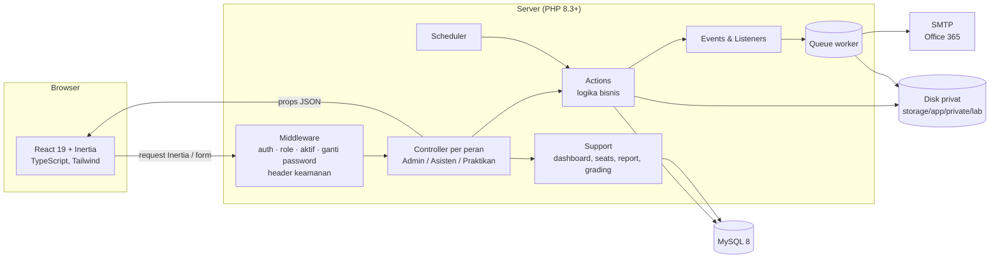
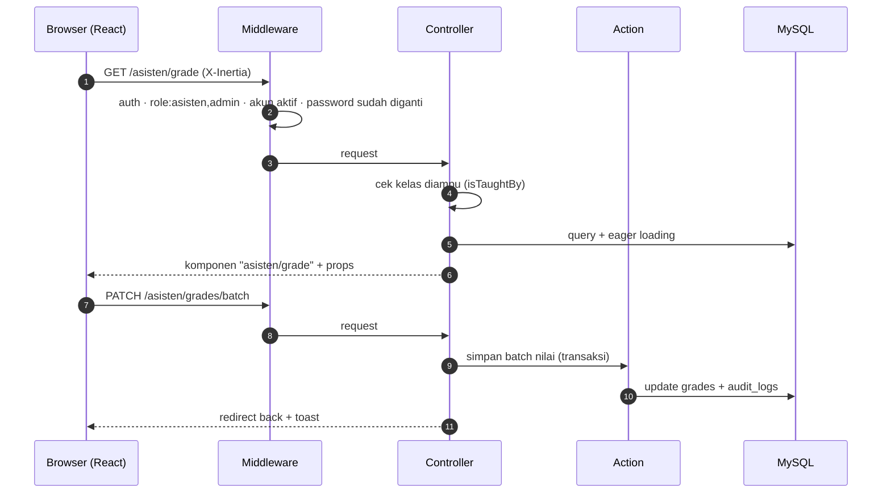
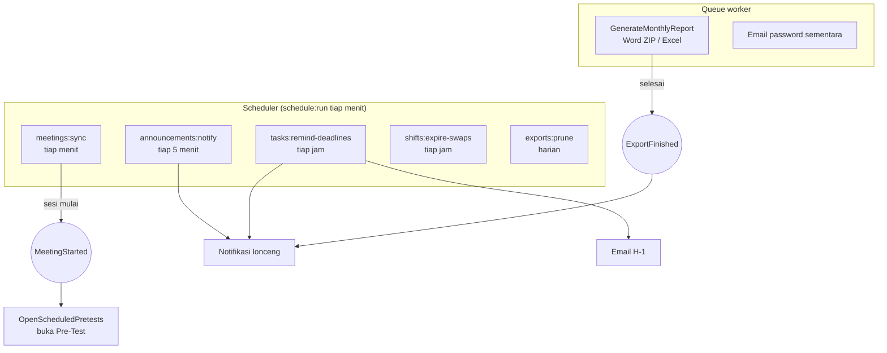
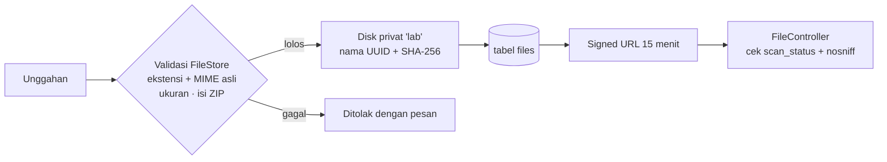

# 03 · Arsitektur

[← Kembali ke README](../README.md)

IR Lab adalah **monolit Laravel** dengan antarmuka **React yang dirender lewat Inertia**. Tidak ada API
terpisah: controller Laravel mengembalikan halaman Inertia beserta props-nya, dan React merender di browser.
Satu basis kode, satu deploy, tanpa sinkronisasi skema API.

## Gambaran komponen

## Struktur kode

| Lokasi                                           | Isi                                                                                             |
| ------------------------------------------------ | ----------------------------------------------------------------------------------------------- |
| `routes/web.php`                                 | Login, lupa password (OTP), pencarian, file bertanda tangan, pengelompokan route per peran      |
| `routes/{admin,asisten,praktikan,settings}.php`  | Route tiap peran (prefix `/admin`, `/asisten`, `/praktikan`)                                    |
| `routes/console.php`                             | Perintah Artisan & jadwal (scheduler)                                                           |
| `app/Http/Controllers/{Admin,Asisten,Praktikan}` | Controller tipis: validasi, otorisasi kepemilikan, render Inertia                               |
| `app/Actions/<Domain>`                           | Logika bisnis yang dipakai ulang (mis. `JoinClass`, `SubmitTask`, `PublishGrades`, `SwapShift`) |
| `app/Support`                                    | Penyusun data halaman: dashboard, denah kursi, rekap, antrean penilaian                         |
| `app/Events`, `app/Listeners`                    | Efek samping: notifikasi, pembukaan Pre-Test otomatis                                           |
| `app/Jobs/GenerateMonthlyReport`                 | Pembuatan rekap bulanan (Word ZIP / Excel) di antrean                                           |
| `resources/js/pages`                             | Halaman Inertia per peran                                                                       |
| `resources/js/components`                        | Komponen bersama (picker tanggal/jam, denah kursi, PDF viewer, dsb.)                            |
| `resources/js/actions`, `routes`                 | Dibuat otomatis oleh **Wayfinder**: route Laravel bertipe di TypeScript                         |

## Alur request

Otorisasi berlapis:

1. **Middleware peran** (`role:`) di setiap grup route; akses ke URL peran lain menghasilkan 403.
2. **Pengecekan kepemilikan** di controller/action, misalnya asisten hanya boleh mengelola kelas yang diampu
   (`LabClass::isTaughtBy`) dan praktikan hanya boleh melihat submission miliknya.
3. Front-end hanya menyembunyikan menu, **bukan** lapisan keamanan.

## Proses latar belakang

| Proses       | Pemicu                                    | Tanpa proses ini                                                                     |
| ------------ | ----------------------------------------- | ------------------------------------------------------------------------------------ |
| Scheduler    | Cron `* * * * * php artisan schedule:run` | Sesi tidak mulai/berhenti otomatis, Pre-Test tidak terbuka, pengingat tidak terkirim |
| Queue worker | `php artisan queue:work` (Supervisor)     | Rekap tertahan "Antre", email password sementara tidak terkirim                      |

Saat ada pengguna membuka dashboard atau halaman sesi, sinkronisasi sesi juga dijalankan (dibatasi
sekali per 20 detik), sehingga status tetap tepat walau scheduler terlambat.

## Penyimpanan file

- Semua file (submission, lampiran soal, foto laporan, avatar, hasil ekspor) disimpan di
  `storage/app/private/lab`, **di luar web root**.
- Nama asli hanya disimpan di database; nama di disk berupa UUID.
- File hanya bisa diunduh lewat **URL bertanda tangan** yang berlaku 15 menit.

Detail di [10 · Keamanan](10-security.md).

## Frontend

- **Inertia 3** menghubungkan route Laravel ke halaman React tanpa API terpisah. Props dikirim sebagai JSON;
  polling parsial (`usePoll`, `only: [...]`) memperbarui bagian tertentu saja, misalnya panel sesi berlangsung.
- **Wayfinder** membuat fungsi route & action bertipe dari controller Laravel, sehingga URL tidak ditulis manual.
- Komponen UI di atas **Radix UI** + Tailwind 4. Dropdown & tanggal selalu memakai `SelectField`,
  `DateField`, `TimeField`, dan `CalendarFilter`, tidak memakai input bawaan browser.
- Semua waktu ditampilkan dalam **WIB** (`resources/js/lib/datetime.ts`).

## Kualitas

| Alat               | Cakupan                                                       |
| ------------------ | ------------------------------------------------------------- |
| PHPUnit            | 299 feature/unit test (SQLite in-memory)                      |
| PHPStan + Larastan | Level 7, 0 error, tanpa baseline                              |
| Pint               | Gaya kode PHP                                                 |
| Vite+ (`vp check`) | Format & lint TypeScript/CSS/Markdown                         |
| `tsc --noEmit`     | Type-check TypeScript                                         |
| GitHub Actions     | `composer ci:check` di setiap push ke `main` dan pull request |
