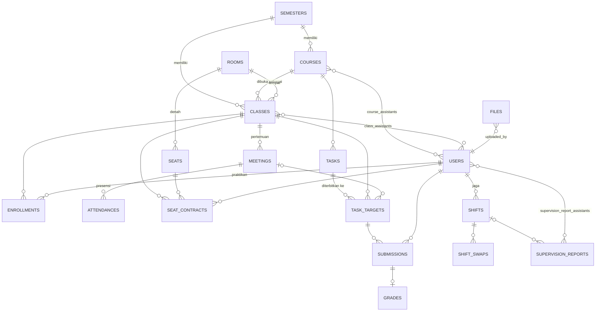

# 04 · Database

[← Kembali ke README](../README.md)

MySQL 8, `utf8mb4`. Skema hanya diubah lewat **migration** (`database/migrations`). Hampir semua data
akademik terikat ke **semester**, sehingga pergantian semester tidak mencampur data lama.

## ERD inti

`files` bersifat **polimorfik** (`owner_type`, `owner_id`) dan dipakai oleh submission, lampiran tugas, foto
laporan, avatar, poster program, dan hasil ekspor.

## Tabel utama

### Akademik

| Tabel                                   | Isi                                                                           | Catatan                                                      |
| --------------------------------------- | ----------------------------------------------------------------------------- | ------------------------------------------------------------ |
| `semesters`                             | Nama, rentang tanggal, status (`draft`, `active`, `archived`)                 | Hanya satu yang aktif                                        |
| `courses`                               | Kode, nama, SKS, warna, bobot Pre-Test/Post-Test/Laporan                      | Usulan asisten berstatus `pending` sampai disetujui Admin    |
| `classes`                               | Mata kuliah, hari & jam, ruang, kuota, `join_token`, `is_locked`, dosen       | Usulan asisten perlu persetujuan; token bisa dibuat ulang    |
| `class_assistants`, `course_assistants` | Asisten pengampu                                                              | Tabel pivot                                                  |
| `enrollments`                           | Praktikan di kelas, `joined_at`, alasan dikeluarkan                           | Soft delete; satu mata kuliah hanya satu kelas per praktikan |
| `meetings`                              | Nomor, tanggal, **topik**, asisten penanggung jawab, `started_at`, `ended_at` | Sesi mulai/selesai otomatis sesuai jam kelas                 |
| `attendances`                           | Status `hadir`, `izin`, `sakit`, `alfa` per pertemuan                         | Dicatat asisten di layar sesi                                |

### Tugas & penilaian

| Tabel          | Isi                                                                                                       | Catatan                                                       |
| -------------- | --------------------------------------------------------------------------------------------------------- | ------------------------------------------------------------- |
| `tasks`        | Jenis (`pretest`, `posttest`, `report`), soal (JSON TipTap), skor maks, format diterima, aturan terlambat | Satu tugas dapat diterbitkan ke beberapa kelas                |
| `task_targets` | Tugas × kelas: `open_at`, `due_at`, `closed_at`, `window_minutes`                                         | `window_minutes` untuk Pre-Test mode Sesi Berjalan            |
| `submissions`  | Jawaban teks, waktu kumpul, `is_late`, `late_minutes`, versi, nomor tanda terima                          | Versi lama tetap disimpan; `is_current` menandai yang terbaru |
| `grades`       | Skor, feedback, status (`draft`, `published`), versi                                                      | Praktikan hanya melihat nilai `published`                     |

### Operasional asisten

| Tabel                           | Isi                                                                                | Catatan                                    |
| ------------------------------- | ---------------------------------------------------------------------------------- | ------------------------------------------ |
| `shifts`                        | Jadwal jaga asisten per tanggal & jam                                              |                                            |
| `shift_swaps`                   | Pengajuan tukar shift, status, catatan                                             | Kedaluwarsa 24 jam sebelum shift           |
| `supervision_reports`           | Laporan mengawas: kegiatan, materi, catatan, status, verifikator, `editable_until` | Dapat diubah sampai H+1 pukul 23.59        |
| `supervision_report_assistants` | Tim jaga per laporan, `position` (1 = penanggung jawab)                            | Pivot bertipe `SupervisionReportAssistant` |
| `honor_rates`, `honor_recaps`   | Tarif per jam & rekap honor bulanan                                                | Disetujui Sekretaris/Bendahara             |
| `exports`                       | Permintaan rekap (ZIP/Excel), progres, file hasil                                  | Kedaluwarsa 24 jam, dihapus setelah 7 hari |

### Ruang & kursi

| Tabel            | Isi                                                                                     |
| ---------------- | --------------------------------------------------------------------------------------- |
| `rooms`          | Nama, jumlah baris & kolom grid                                                         |
| `seats`          | Sel denah: `type` (`seat`, `assistant_desk`, `aisle`, `disabled`), label (mis. `PC-01`) |
| `seat_contracts` | Kursi praktikan di satu kelas + snapshot nama/NIM/jurusan                               |

### Sistem

| Tabel                   | Isi                                                                                        |
| ----------------------- | ------------------------------------------------------------------------------------------ |
| `users`                 | NIM, nama, email, telepon, avatar, `role`, `position`, `is_active`, `must_change_password` |
| `files`                 | Metadata file: disk, path UUID, nama asli, MIME, ukuran, SHA-256, `scan_status`            |
| `audit_logs`            | Aksi sensitif: pelaku, objek, `before_json`, `after_json`, IP                              |
| `notifications`         | Notifikasi lonceng (bawaan Laravel)                                                        |
| `announcements`         | Pengumuman global/kelas, sematkan, jadwal terbit & kedaluwarsa                             |
| `settings`              | Pengaturan sistem (key-value JSON): batas idle, batas unggah, registrasi                   |
| `password_reset_codes`  | Kode OTP reset password (di-hash), jumlah percobaan (maks. 5), kedaluwarsa 10 menit        |
| `programs`, `program_*` | Modul Program (ditutup sementara)                                                          |

Tabel bawaan Laravel lain: `sessions`, `cache`, `jobs`, `failed_jobs`, `migrations`.

## Aturan pengelolaan data

- **Jangan `migrate:fresh` pada database kerja.** Ubah skema dengan migration baru dan `php artisan migrate`.
  Di produksi, perintah destruktif diblokir (`DB::prohibitDestructiveCommands`).
- Penulisan yang rawan bentrok (gabung kelas, kontrak kursi, simpan batch nilai) memakai transaksi dan
  row locking.
- Semua tanggal di model bertipe `CarbonImmutable`, zona waktu Asia/Jakarta.
