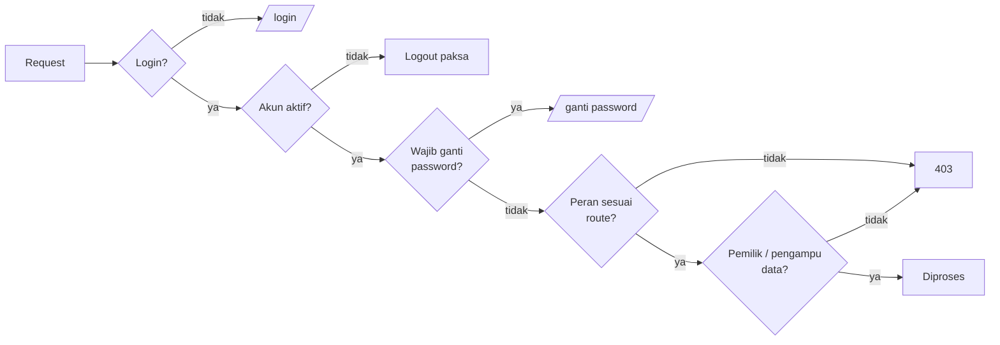

# 05 · Peran & Hak Akses

[← Kembali ke README](../README.md)

## Tiga peran, satu jabatan

|                    | Praktikan                                                   | Asisten              | Admin                           |
| ------------------ | ----------------------------------------------------------- | -------------------- | ------------------------------- |
| Dashboard          | `/praktikan/dashboard`                                      | `/asisten/dashboard` | `/admin/dashboard`              |
| Route              | `/praktikan/*`                                              | `/asisten/*`         | `/admin/*` **dan** `/asisten/*` |
| Cara mendapat akun | Registrasi mandiri (email kampus) atau dibuat/diimpor Admin | Dibuat Admin         | `AdminSeeder` atau dibuat Admin |

- Setiap akun punya **satu peran** (`users.role`).
- Asisten dapat diberi **jabatan Sekretaris/Bendahara** (`users.position`). Jabatan bukan peran baru;
  jabatan hanya membuka dua hak tambahan: **verifikasi laporan mengawas** dan **persetujuan rekap honor**.
- Admin memiliki seluruh hak Asisten ditambah menu Master Data.

## Lapisan pemeriksaan

| Lapisan            | Implementasi                                                                  |
| ------------------ | ----------------------------------------------------------------------------- |
| Login              | Middleware `auth` + `verified`                                                |
| Akun aktif         | `EnsureUserIsActive`: akun nonaktif langsung keluar                           |
| Password sementara | `EnsurePasswordIsChanged`: wajib ganti sebelum mengakses menu lain            |
| Peran              | `EnsureUserHasRole` (`role:praktikan`, `role:asisten,admin`, `role:admin`)    |
| Kepemilikan        | Controller/action, mis. `LabClass::isTaughtBy($user)` untuk kelas yang diampu |
| Jabatan            | `User::canVerifyReports()`, `User::canApproveHonor()`                         |

## Matriks hak akses

**C** = buat, **R** = lihat, **U** = ubah, **D** = hapus/arsip, **Own** = milik sendiri,
**Ampu** = kelas/mata kuliah yang diampu, **—** = tidak ada akses.

| Modul                                            | Praktikan                   | Asisten                                               | Admin                                    |
| ------------------------------------------------ | --------------------------- | ----------------------------------------------------- | ---------------------------------------- |
| Semester (buat, aktifkan, arsip, salin struktur) | —                           | R                                                     | CRUD                                     |
| Mata kuliah & bobot nilai                        | R (yang diikuti)            | R, **ajukan** baru                                    | CRUD, setujui/tolak                      |
| Kelas & jadwal                                   | R (Own)                     | CRU (Ampu), **ajukan** kelas baru                     | CRUD, setujui/tolak                      |
| Token kelas & kunci kelas                        | Gabung via token            | CRU (Ampu)                                            | CRUD                                     |
| Anggota kelas                                    | R teman sekelas             | R, impor, keluarkan (Ampu)                            | CRUD                                     |
| Pertemuan & topik                                | R                           | CRU (Ampu)                                            | CRUD                                     |
| Sesi & presensi                                  | R (Own)                     | CRU (Ampu)                                            | CRUD                                     |
| Tugas (Pre/Post-Test, Laporan)                   | R, kumpulkan (Own)          | CRUD (Ampu)                                           | CRUD                                     |
| Nilai & feedback                                 | R yang dipublikasikan (Own) | CRU, publikasikan (Ampu)                              | CRUD                                     |
| Kontrak kursi                                    | C, R kelas yang diikuti     | R (Ampu)                                              | CRUD, koreksi                            |
| Denah ruang                                      | R                           | R                                                     | CRUD                                     |
| Laporan mengawas                                 | —                           | CRU (Own); **Sekretaris/Bendahara: verifikasi semua** | R semua, verifikasi, buka kunci          |
| Generate rekap                                   | —                           | Own; **Sekretaris/Bendahara: setujui honor**          | Semua asisten                            |
| Jadwal shift & tukar shift                       | —                           | Ajukan & setujui (Own)                                | R, kelola                                |
| Pengumuman                                       | R                           | C (kelas Ampu)                                        | CRUD (global & kelas)                    |
| Pengguna                                         | —                           | —                                                     | CRUD, impor, reset password, nonaktifkan |
| Audit log                                        | —                           | —                                                     | R                                        |
| Pengaturan sistem                                | —                           | —                                                     | RU                                       |
| Program _(ditutup)_                              | R, daftar                   | CRUD                                                  | CRUD                                     |

## Aturan khusus Admin

- Admin **tidak dapat** menonaktifkan atau menurunkan peran akunnya sendiri.
- **Admin aktif terakhir** tidak dapat dinonaktifkan atau diturunkan perannya oleh siapa pun.
- Reset password oleh Admin mengakhiri semua sesi akun tersebut dan mengirim password sementara.
- Bila semua Admin terkunci: `php artisan lab:recover-admin <email>` dari server
  (lihat [08 · Deployment](08-deployment.md#8-darurat-semua-admin-terkunci)).
