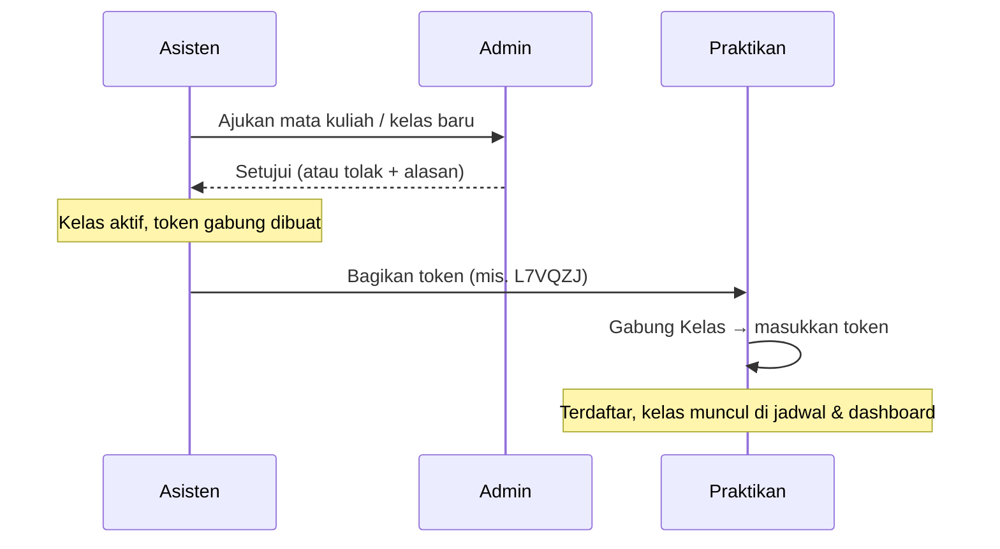

# Kelas & Enrollment

[← Daftar fitur](README.md)

## Alur pembukaan kelas

## Aturan

| Aturan                     | Rincian                                                                                                                                       |
| -------------------------- | --------------------------------------------------------------------------------------------------------------------------------------------- |
| Persetujuan                | Mata kuliah dan kelas usulan Asisten berstatus _menunggu_ sampai disetujui Admin (FR-AS-02, FR-ADM-03).                                       |
| Token                      | Kode unik per kelas. Asisten dapat membuat ulang token; token lama langsung tidak berlaku (US-A01-3). Nilai token tidak dicatat di audit log. |
| Kunci kelas                | Asisten dapat mengunci kelas: praktikan baru tidak dapat bergabung, anggota lama tetap (US-A01-4).                                            |
| Kuota                      | Bila anggota mencapai kuota, kelas **terkunci otomatis** dan asisten diberi notifikasi.                                                       |
| Satu kelas per mata kuliah | Praktikan hanya boleh berada di satu kelas untuk satu mata kuliah (FR-ENR-05).                                                                |
| Batas percobaan            | Gabung kelas dibatasi rate limit untuk mencegah tebak token.                                                                                  |

## Anggota kelas

- Asisten melihat daftar anggota beserta kursi dan rata-rata nilai sementara.
- Ekspor anggota ke Excel; impor praktikan ke kelas dari CSV/Excel (FR-AC-03).
- Asisten dapat mengeluarkan praktikan dengan alasan. Data enrollment disimpan (soft delete) untuk audit.

## Kode terkait

`app/Actions/Enrollment/JoinClass.php`, `app/Actions/LabClass/ManageClassAccess.php`,
`app/Http/Controllers/Asisten/ClassController.php`, `ClassDetailController.php`.
