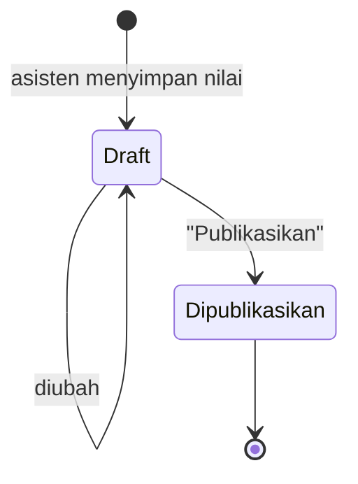

# Penilaian

[← Daftar fitur](README.md)


## Dua cara menilai

| Mode                    | Kegunaan                                                                                                                                                     |
| ----------------------- | ------------------------------------------------------------------------------------------------------------------------------------------------------------ |
| **Tabel nilai (batch)** | Semua praktikan satu tugas dalam satu tabel: isi nilai & catatan, simpan sekaligus.                                                                          |
| **Split-Screen Grade**  | Jawaban di kiri (PDF lewat PDF.js, atau isi ZIP lewat Code Viewer), form nilai & feedback di kanan. Tombol _Simpan & Lanjut_ pindah ke praktikan berikutnya. |


- Kiriman terlambat ditandai beserta lamanya. Penalti keterlambatan dari pengaturan tugas ditampilkan
  sebagai acuan bagi asisten.
- Code Viewer hanya menampilkan file teks ≤ 1 MB dan tidak pernah menjalankan kode.

## Draft → Publikasi



- Praktikan **hanya melihat nilai yang dipublikasikan**, beserta feedback-nya.
- Publikasi mengirim notifikasi ke praktikan terkait dan tercatat di audit log.

## Nilai akhir

Nilai akhir mata kuliah adalah **rata-rata berbobot** tiga komponen. Bobotnya diatur Admin per mata kuliah:

```
komponen  = rata-rata (nilai / skor maks × 100) dari nilai yang sudah dipublikasikan
nilai akhir = Σ (komponen × bobot) / Σ bobot komponen yang sudah ada nilainya
```

Selama semester berjalan, komponen yang belum punya nilai tidak dihitung dan bobotnya dinormalisasi
(**nilai sementara**).

| Nilai akhir | Huruf |
| ----------- | ----- |
| ≥ 85        | A     |
| ≥ 80        | AB    |
| ≥ 70        | B     |
| ≥ 65        | BC    |
| ≥ 55        | C     |
| ≥ 40        | D     |
| < 40        | E     |

> Skala huruf di `app/Support/Grading/FinalScore.php` adalah asumsi umum. Sesuaikan dengan kebijakan kampus.

## Ekspor

Asisten dapat mengekspor rekap nilai per kelas ke Excel.

## Kode terkait

`app/Http/Controllers/Asisten/GradeController.php`, `app/Actions/Grade/PublishGrades.php`,
`app/Support/Grading/FinalScore.php`, `app/Support/Grading/GradingQueue.php`,
`resources/js/components/grading/pdf-viewer.tsx`.
