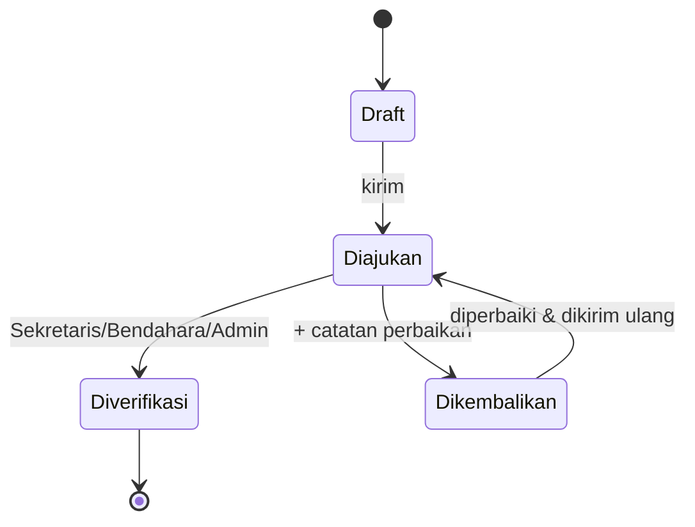

# Laporan Mengawas & Rekap

[← Daftar fitur](README.md)

## Laporan mengawas

Asisten yang berjaga mengisi laporan untuk setiap shift.

- Form **terisi otomatis** dari jadwal shift hari ini, atau shift kemarin yang belum dilaporkan.
- Isian: jam, kelas/kegiatan, materi (otomatis dari topik pertemuan), deskripsi kegiatan, **tim asisten jaga**
  (penanggung jawab + anggota, maks. 4), dan **foto dokumentasi** (wajib, ≤ 5 MB).
- Laporan dapat diubah sampai **H+1 pukul 23.59**, setelah itu terkunci. Admin dapat membuka kunci sampai
  besok 23.59.
- Pencarian mencakup seluruh isi laporan, termasuk hari/tanggal dalam berbagai format ("kamis",
  "1 oktober", "01/10/2026").

### Verifikasi

Hanya laporan **Diverifikasi** yang masuk rekap dan perhitungan honor.

## Generate rekap bulanan

| Format                  | Isi                                                                                                                | Proses                     |
| ----------------------- | ------------------------------------------------------------------------------------------------------------------ | -------------------------- |
| **ZIP (Word per hari)** | Satu file `.docx` _Laporan Kegiatan Harian_ per tanggal, dari template `resources/templates/laporan-mengawas.docx` | Antrean (progres terlihat) |
| **Excel**               | Rekap seluruh laporan pada periode                                                                                 | Antrean                    |
| **Word satu hari**      | Laporan satu tanggal tertentu                                                                                      | Unduh langsung             |

- Asisten biasa merekap laporannya sendiri. Sekretaris/Bendahara dan Admin dapat merekap **semua asisten**.
- File hasil berlaku 24 jam dan dihapus otomatis setelah 7 hari (`exports:prune`).
- Kop & logo laporan diubah langsung di file template Word. Penanda `${...}` jangan dihapus.

## Rekap honor

- Honor = **jam jaga dari laporan terverifikasi × tarif per jam**. Tarif diatur Admin di Pengaturan Sistem
  dan berlaku mulai tanggal tertentu.
- Sekretaris/Bendahara (atau Admin) **menyetujui** rekap honor bulanan; setiap asisten dapat melihat rekap
  miliknya.

## Kode terkait

`app/Actions/Report/SaveSupervisionReport.php`, `app/Jobs/GenerateMonthlyReport.php`,
`app/Support/Reports/DailyActivityReport.php`, `app/Actions/Honor/ComputeHonorRecaps.php`,
`app/Http/Controllers/Asisten/ReportController.php`, `GenerateController.php`.
