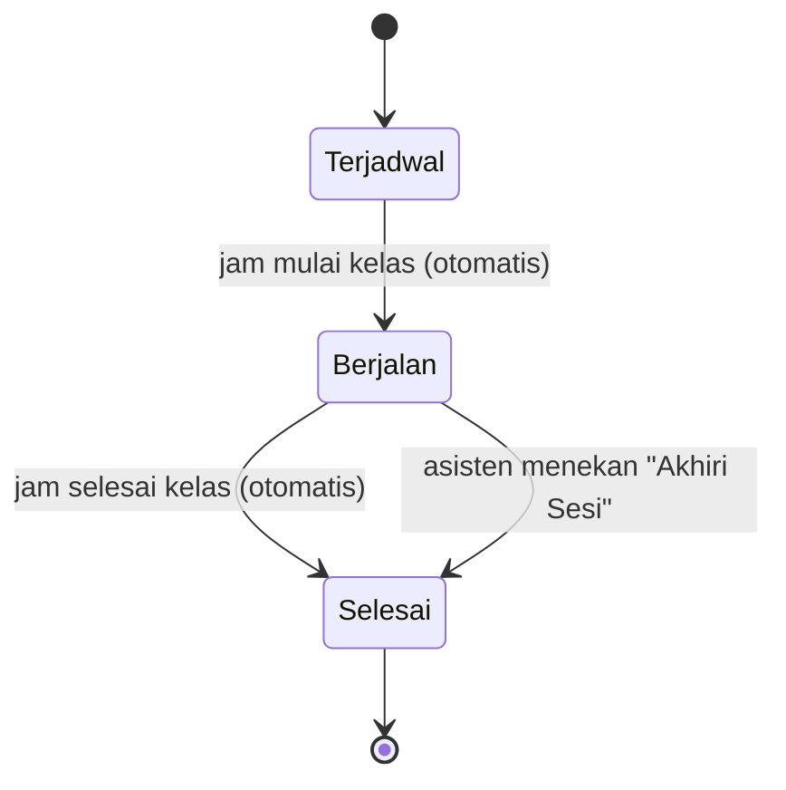
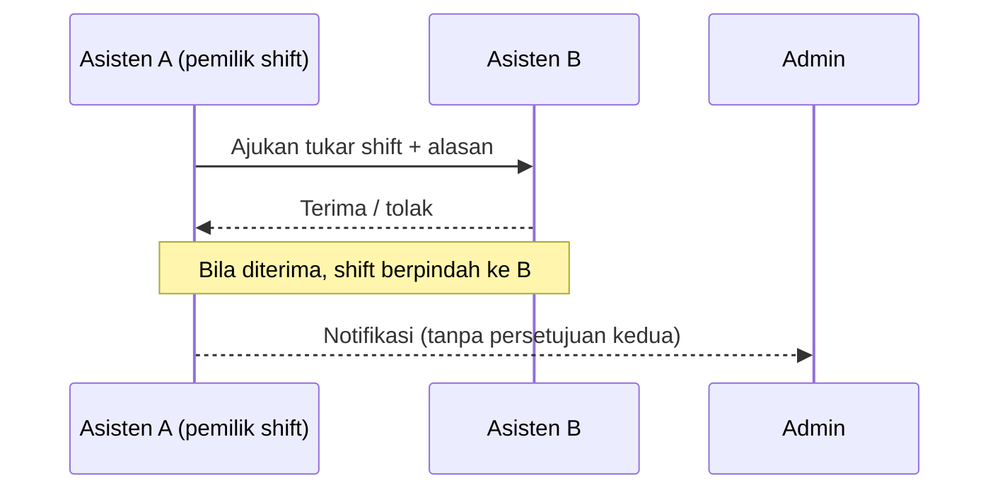

# Jadwal, Sesi & Presensi

[← Daftar fitur](README.md)

## Jadwal

- **Praktikan**: kalender mingguan kelas yang diikuti + daftar pertemuan dan topiknya.
- **Asisten**: kalender kelas yang diampu dan shift jaga, dengan filter "Jadwal Saya" / "Semua Jadwal".
- Warna setiap mata kuliah konsisten di seluruh aplikasi (diatur Admin).
- Semua waktu ditampilkan dalam **WIB**, apa pun zona waktu perangkat.

## Pertemuan & sesi otomatis

Setiap kelas memiliki pertemuan bernomor (P1, P2, …) dengan tanggal, **topik**, dan asisten penanggung jawab.

- Perintah `meetings:sync` berjalan **tiap menit** dan mengisi `started_at` / `ended_at` sesuai jam kelas.
- Saat sesi dimulai, event `MeetingStarted` **membuka Pre-Test** yang dijadwalkan untuk pertemuan itu.
- Dashboard Asisten & Praktikan menampilkan panel **Sesi Berlangsung** yang diperbarui otomatis
  (Praktikan tiap 20 detik, Asisten tiap 30 detik).

## Presensi

- Asisten membuka layar sesi dan menandai tiap praktikan: **Hadir, Izin, Sakit, Alfa**, termasuk aksi
  "Semua Hadir".
- Rekap presensi per kelas: baris praktikan × kolom pertemuan.
- Unduh presensi per sesi sebagai CSV (aman dari formula injection Excel).

## Shift & tukar shift

- Pengajuan paling lambat **24 jam sebelum** shift. Pengajuan yang belum dijawab kedaluwarsa otomatis
  (`shifts:expire-swaps`, tiap jam).
- Kandidat penerima hanya asisten yang tidak bentrok jadwalnya.

## Kode terkait

`app/Actions/Meeting/SyncMeetingSessions.php`, `app/Listeners/OpenScheduledPretests.php`,
`app/Support/Dashboard/LiveSessions.php`, `app/Actions/Shift/SwapShift.php`,
`app/Http/Controllers/Asisten/SessionController.php`.
