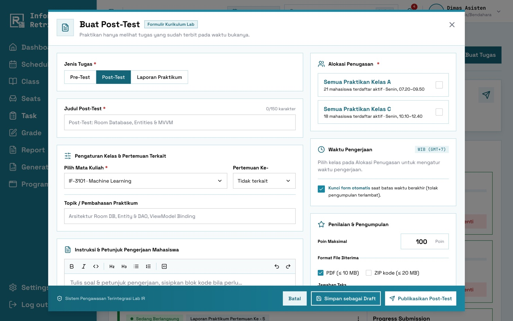
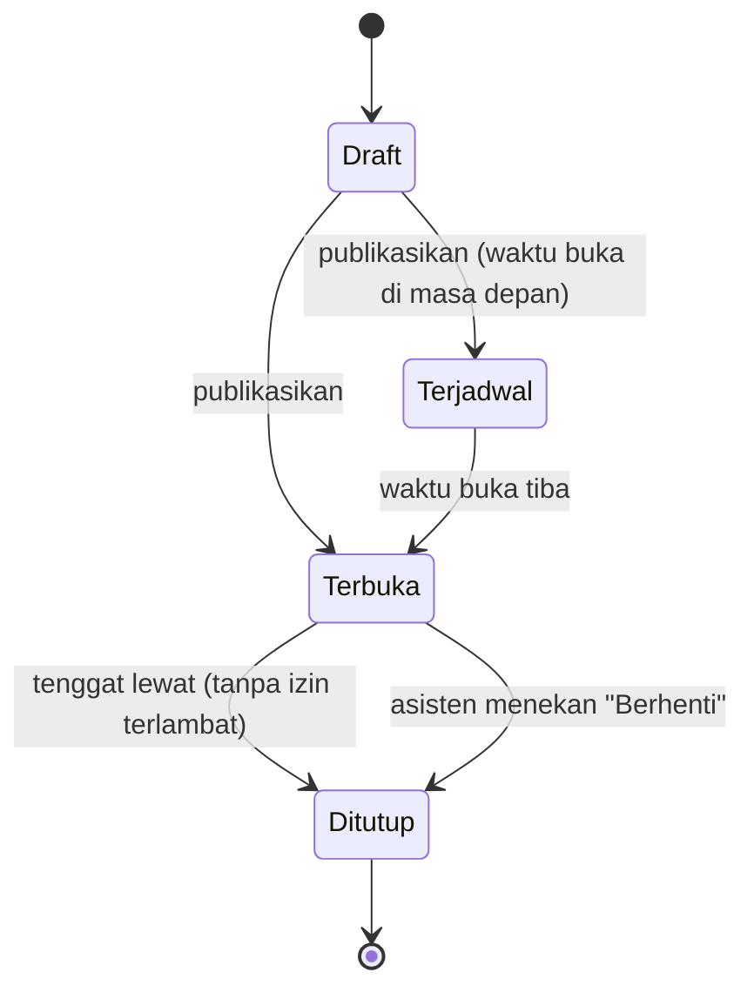

# Tugas & Pengumpulan

[← Daftar fitur](README.md)

## Jenis tugas

| Jenis         | Cara buka                                                                           | Contoh                                   |
| ------------- | ----------------------------------------------------------------------------------- | ---------------------------------------- |
| **Pre-Test**  | Mode **Sesi Berjalan**: terbuka otomatis saat sesi kelas dimulai, berlaku _N_ menit | Tes awal 15 menit                        |
| **Post-Test** | Jadwal tanggal & jam buka sampai tenggat                                            | Dikumpulkan sebelum pertemuan berikutnya |
| **Laporan**   | Jadwal tanggal & jam buka sampai tenggat                                            | Laporan praktikum mingguan               |

Satu tugas dibuat per mata kuliah lalu **diterbitkan ke satu atau beberapa kelas** (`task_targets`).
Setiap kelas dapat punya waktu buka dan tenggat sendiri.

## Membuat tugas

- Soal ditulis di **editor teks kaya** (TipTap) dengan blok kode bersorotan sintaks.
- Lampiran soal: maks. 5 file × 20 MB.
- Pengaturan: skor maksimum, format diterima (PDF, ZIP, gambar), jawaban teks (wajib/opsional/tidak),
  pertemuan terkait, dan **izin terlambat** dengan penalti per jam atau per hari.
- Simpan sebagai **Draft** atau **Publikasikan**. Tugas yang sudah terbit tidak kembali menjadi Draft hanya
  karena disimpan ulang.
- Saat berjalan, asisten dapat **menambah waktu** atau **menghentikan** pengumpulan. Praktikan diberi
  notifikasi.

## Status tugas

Tugas yang mengizinkan keterlambatan tetap **Terbuka** setelah tenggat. Kiriman setelah tenggat ditandai
_terlambat_ beserta lamanya.

## Pengumpulan (Praktikan)

- Unggah file sesuai format dan/atau isi jawaban teks.
- Setiap kiriman mendapat **nomor tanda terima** (mis. `IRL-261021-000123`) sebagai bukti.
- Kirim ulang sebelum tutup akan membuat **versi baru**; versi lama tetap disimpan.
- File divalidasi ekstensi **dan** isi aslinya; ZIP diperiksa dari path berbahaya, symlink, dan zip bomb.
  Lihat [Keamanan](../10-security.md).
- Pengingat tenggat **H-1** dikirim lewat lonceng dan email bagi yang belum mengumpulkan.

## Kode terkait

`app/Actions/Task/SaveTask.php`, `SubmitTask.php`, `RemindDeadlines.php`, `app/Models/TaskTarget.php`
(`state()`, scope `open()`), `app/Support/Files/FileStore.php`.
