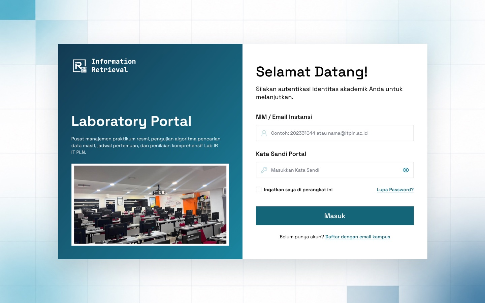
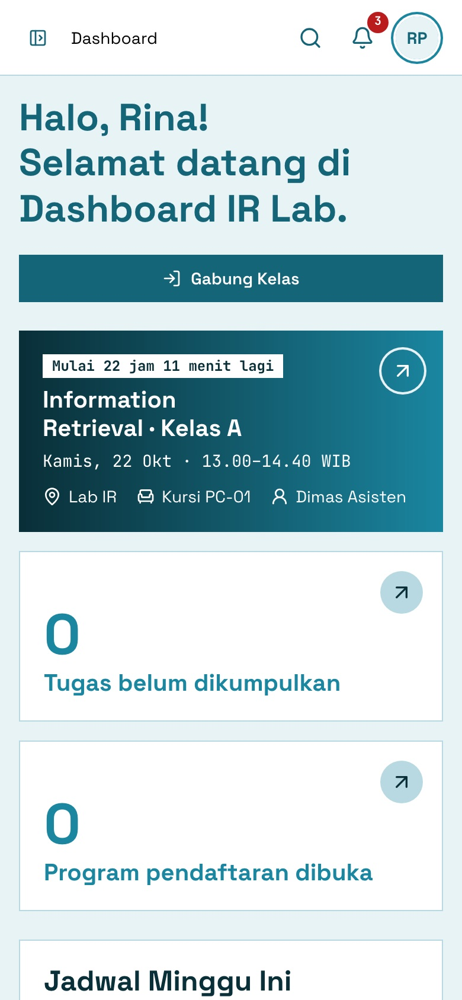

# 09 · Panduan Pengguna

[← Kembali ke README](../../README.md)

| Panduan                   | Untuk                                              |
| ------------------------- | -------------------------------------------------- |
| [Praktikan](praktikan.md) | Mahasiswa peserta praktikum                        |
| [Asisten](asisten.md)     | Asisten lab, termasuk jabatan Sekretaris/Bendahara |
| [Admin](admin.md)         | Koordinator/Kepala Lab                             |

## Masuk ke aplikasi

1. Masuk dengan **NIM** atau **email kampus** beserta kata sandi.
2. Setelah login, Anda diarahkan ke dashboard sesuai peran.
3. Akun baru (dibuat Admin) wajib **mengganti password sementara** saat login pertama.

### Lupa password

1. Klik **Lupa Password?** dan masukkan email kampus (@itpln.ac.id).
2. Masukkan **kode 6 digit** yang dikirim ke email. Kode berlaku 10 menit, maks. 5 kali percobaan.
3. Buat password baru (min. 8 karakter, kombinasi huruf & angka). Sesi di perangkat lain akan diakhiri.

### Hal umum

- **Ctrl K / ⌘K**: pencarian cepat dari halaman mana pun.
- **Lonceng**: notifikasi (nilai terbit, tugas dibuka, pengingat tenggat, dll.).
- **Settings**: ubah profil (nama, telepon, foto) dan password.
- Sesi berakhir otomatis setelah **30 menit** tidak aktif.
- Tampilan menyesuaikan layar ponsel.

