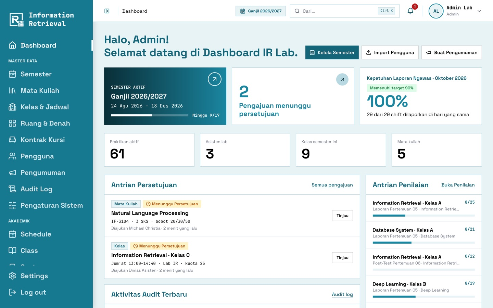
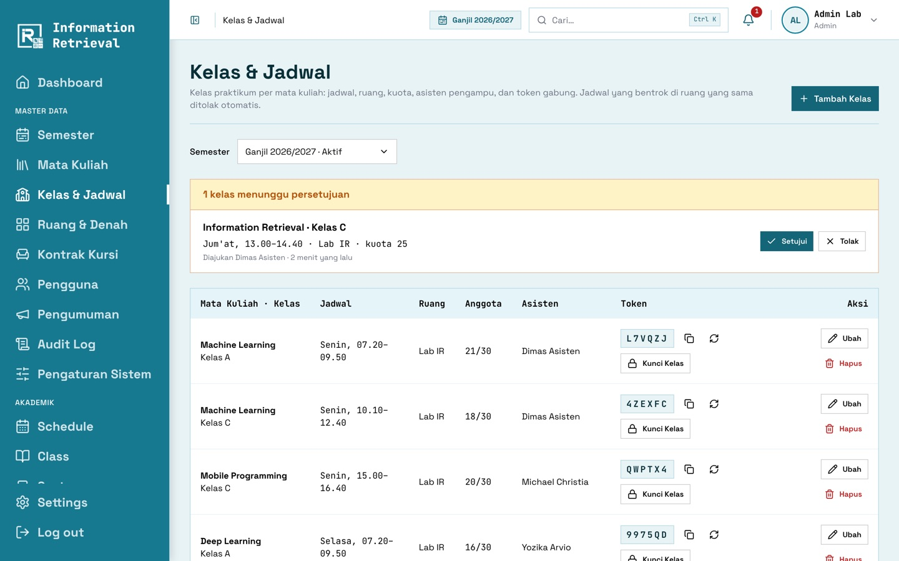
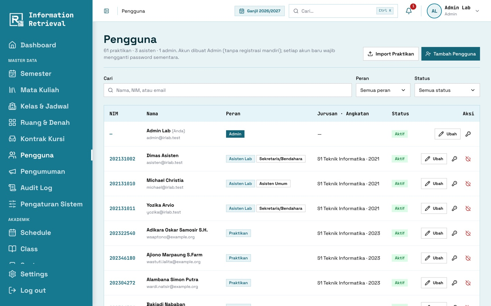
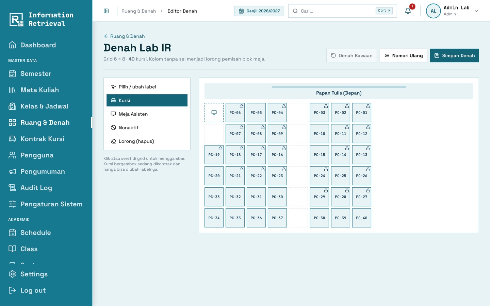
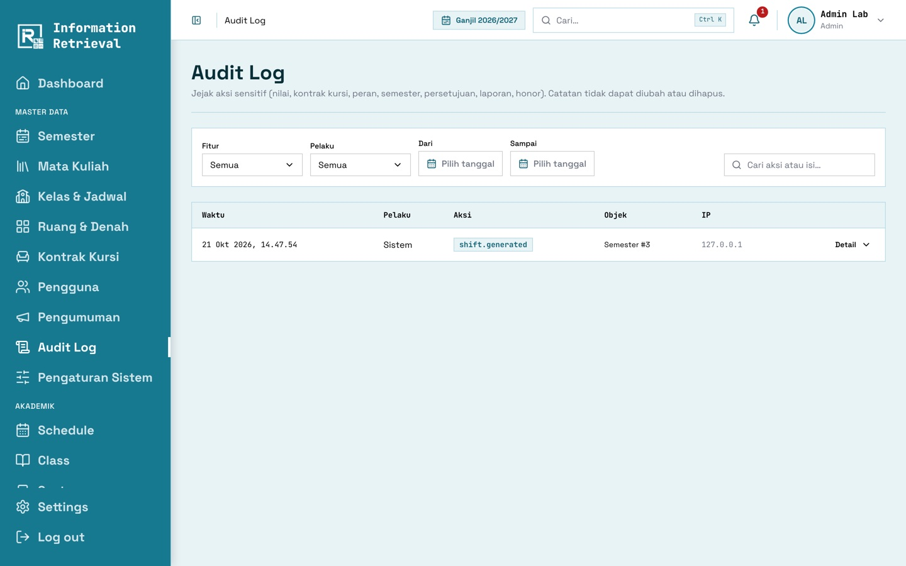
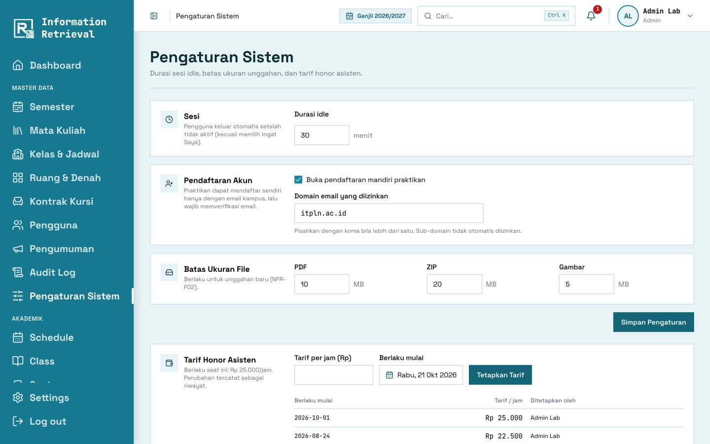

# Panduan Admin

[← Panduan pengguna](README.md)

Admin memiliki menu **Master Data** dan seluruh menu **Akademik** milik Asisten.

## Dashboard

Semester aktif, pengajuan yang menunggu persetujuan, kepatuhan laporan mengawas bulan ini, jumlah
praktikan/asisten/kelas, antrean persetujuan, antrean penilaian, dan aktivitas audit terbaru.

## Awal semester

1. **Semester** → buat semester baru → **Salin Struktur** dari semester sebelumnya (mata kuliah & bobot) → **Aktifkan**.
2. **Mata Kuliah**: periksa kode, warna, dan bobot nilai (Pre-Test/Post-Test/Laporan).
3. **Kelas & Jadwal**: buat kelas semester baru, lalu atur hari, jam, kuota, asisten pengampu, dan **nama dosen**.
4. Setujui atau tolak **pengajuan** mata kuliah/kelas dari asisten.

## Pengguna

- **Tambah Pengguna** atau **Import Praktikan** (unduh template CSV/Excel terlebih dahulu).
- Password sementara dikirim ke email pengguna.
- Ubah peran & jabatan (Sekretaris/Bendahara), reset password, dan aktif/nonaktifkan akun.

> Anda tidak dapat menonaktifkan akun sendiri, dan Admin aktif terakhir tidak dapat dinonaktifkan.

## Ruang & denah

1. **Ruang & Denah** → **Edit Denah**.
2. Pilih alat (kursi, meja asisten, lorong, nonaktif) lalu klik sel grid.
3. **Nomori Ulang** untuk label `PC-01`, `PC-02`, …, lalu **Simpan Denah**.

**Kontrak Kursi** dipakai untuk memindahkan atau menghapus kursi praktikan bila ada kesalahan.

## Pengumuman

Buat pengumuman global (atau untuk peran tertentu). Pengumuman dapat disematkan, dijadwalkan terbit, dan
diberi waktu kedaluwarsa.

## Audit log & pengaturan

- **Audit Log**: telusuri siapa mengubah apa, kapan, dan dari IP mana. Data sebelum & sesudah tersedia.
- **Pengaturan Sistem**: batas idle, batas ukuran unggahan, registrasi mandiri & domain email, tarif honor.

