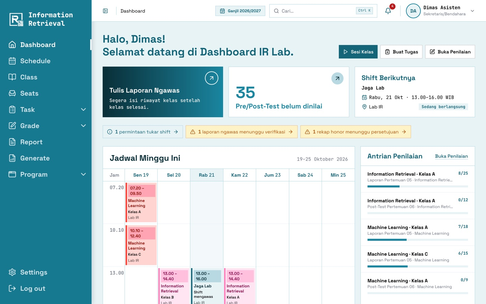
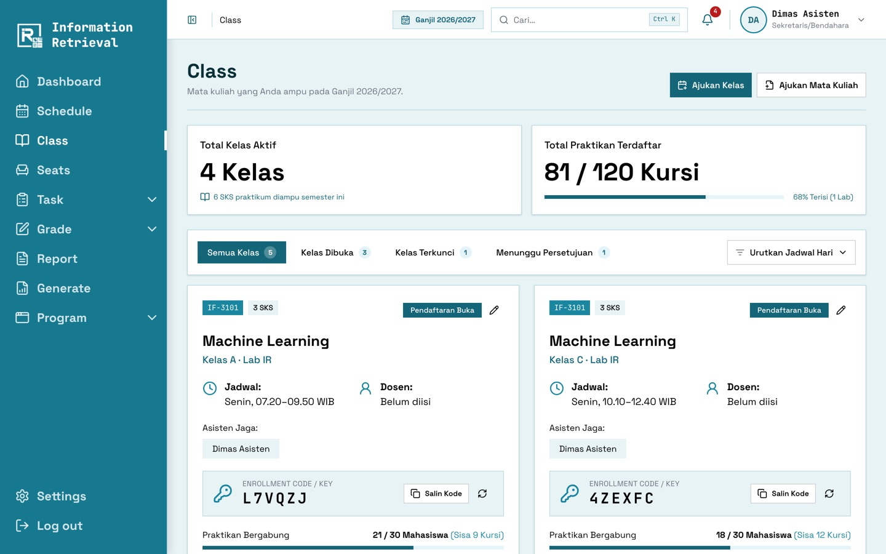
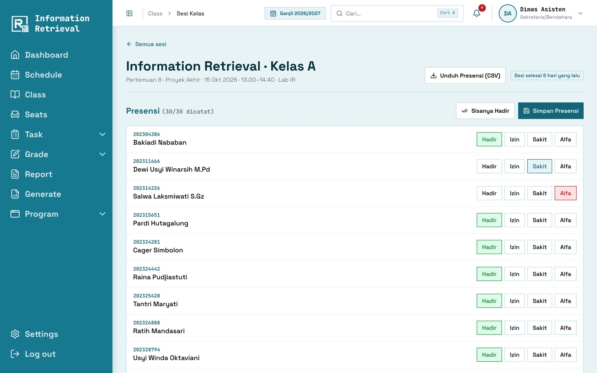
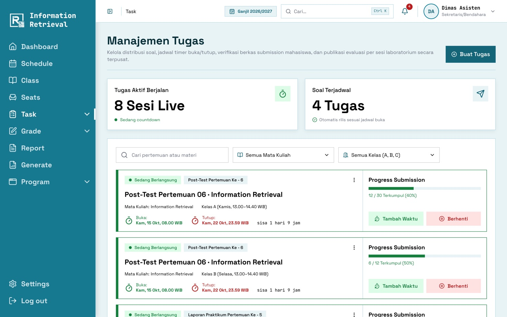
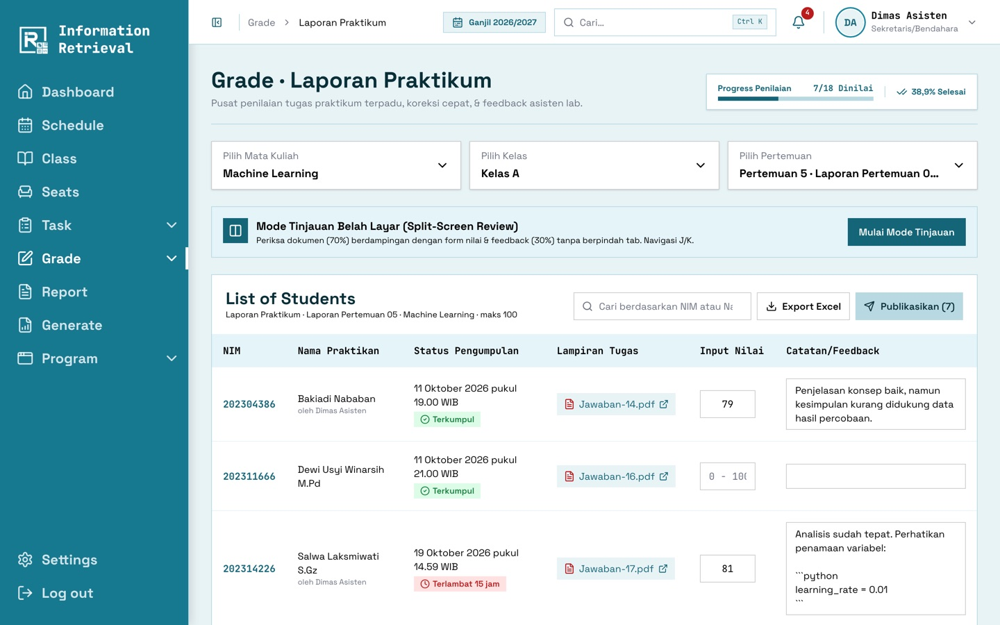
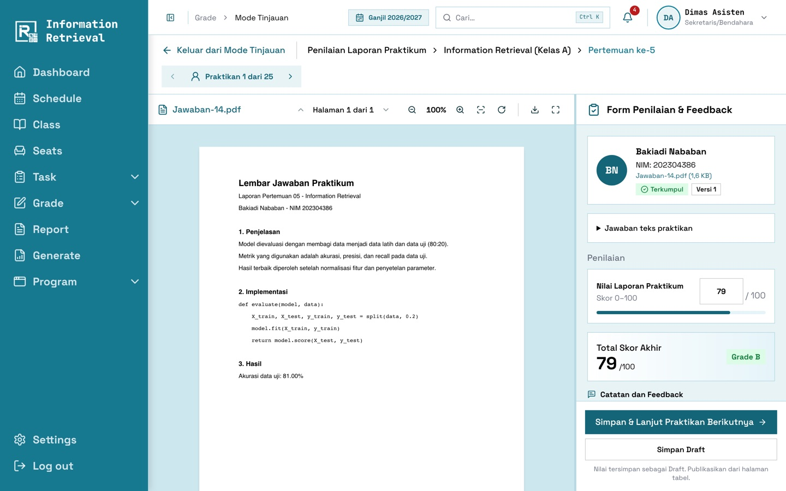
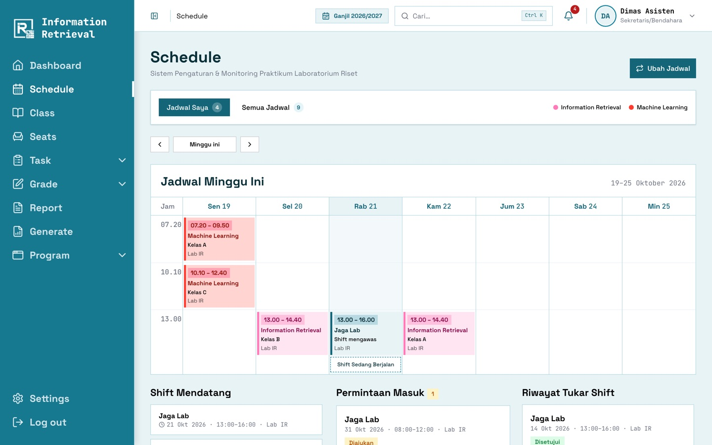
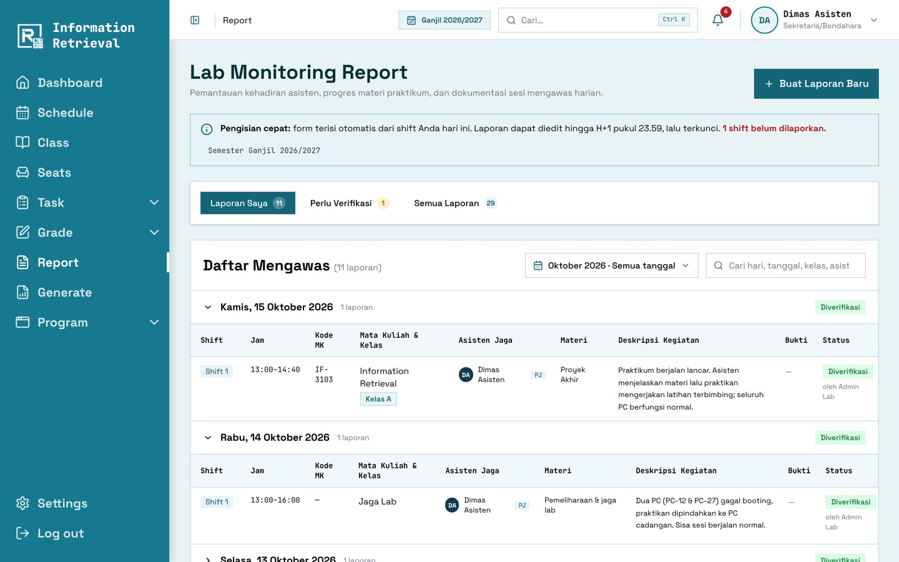
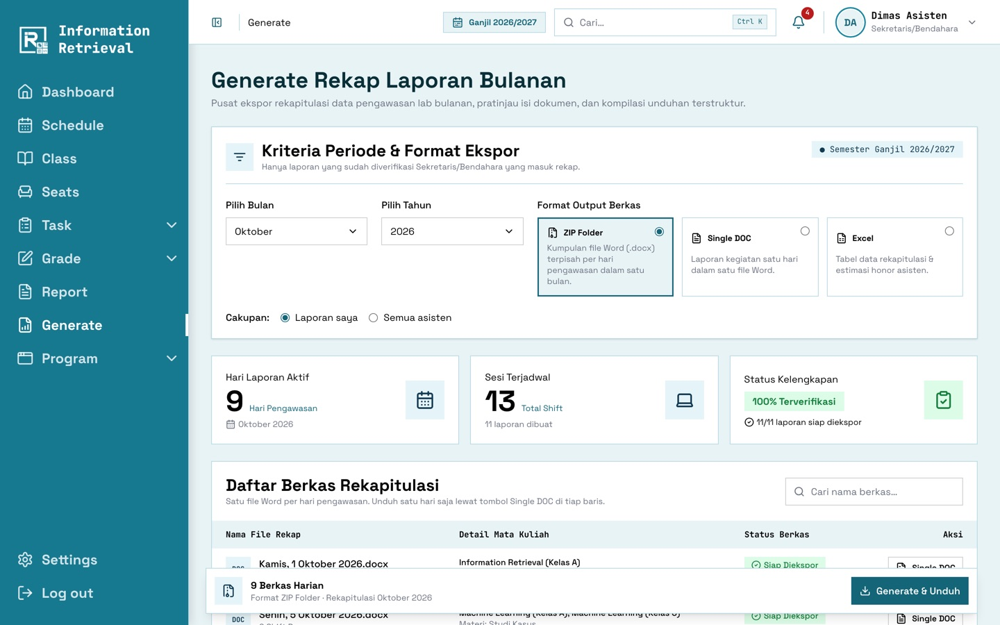

# Panduan Asisten

[← Panduan pengguna](README.md)

## Dashboard

- **Sesi Berlangsung**: pintasan presensi dan membuat Pre/Post-Test untuk kelas yang sedang berjalan.
- Laporan mengawas yang belum diisi, Pre/Post-Test yang belum dinilai, dan shift berikutnya.
- **Jadwal Minggu Ini** dan **Antrean Penilaian**.

## 1. Mengelola kelas

- Menu **Class** menampilkan kelas yang Anda ampu beserta **token gabung** (salin / buat ulang) dan
  jumlah praktikan.
- **Ajukan Kelas** atau **Ajukan Mata Kuliah** baru. Pengajuan aktif setelah disetujui Admin.
- Di detail kelas: anggota (ekspor Excel, impor, keluarkan), pertemuan & topik, rekap presensi, pengaturan
  (kunci kelas), dan pengumuman kelas.

## 2. Menjalankan sesi & presensi

1. Sesi **mulai otomatis** sesuai jam kelas dan muncul di dashboard.
2. Buka sesi, lalu tandai setiap praktikan: **Hadir / Izin / Sakit / Alfa** (atau _Semua Hadir_).
3. **Simpan Presensi**. Rekap dapat diunduh sebagai CSV.
4. Bila kelas selesai lebih awal, tekan **Akhiri Sesi**.

## 3. Membuat tugas

1. Menu **Task** → **Buat Tugas**, lalu pilih jenis: Pre-Test, Post-Test, atau Laporan.
2. Pilih mata kuliah, pertemuan, dan **kelas tujuan**.
3. Tulis soal di editor (mendukung blok kode) dan lampirkan file bila perlu.
4. Atur waktu: Pre-Test cukup durasi (menit), sedangkan Post-Test/Laporan memakai tanggal buka & tenggat.
5. Atur skor maksimum, format file, jawaban teks, dan izin terlambat.
6. **Simpan sebagai Draft** atau **Publikasikan**.

Saat tugas berjalan, gunakan **Tambah Waktu** atau **Berhenti** pada kartu tugas.

## 4. Menilai

- Menu **Grade**: pilih mata kuliah, kelas, dan tugas. Isi nilai & catatan di tabel lalu **Simpan**.
- **Mode Tinjauan (Split-Screen)**: jawaban di kiri, form di kanan. **Simpan & Lanjut** berpindah ke
  praktikan berikutnya.

- Nilai tersimpan sebagai **Draft**. Tekan **Publikasikan** agar praktikan dapat melihatnya.

## 5. Jadwal shift & tukar shift

1. Menu **Schedule** menampilkan kelas dan shift jaga Anda.
2. Untuk menukar shift, klik **Ubah Jadwal · Tukar Shift**, pilih shift, lalu pilih asisten pengganti (hanya yang
   tidak bentrok) dan tulis alasannya.
3. Asisten tujuan menerima atau menolak. Pengajuan paling lambat 24 jam sebelum shift.

## 6. Laporan mengawas

1. Menu **Report** → **Buat Laporan Baru**. Form terisi dari shift hari ini (atau kemarin).
2. Lengkapi kegiatan, materi, deskripsi, tim jaga, dan **foto dokumentasi**.
3. **Kirim**. Laporan masih bisa diubah sampai H+1 pukul 23.59.

**Sekretaris/Bendahara**: tab **Perlu Verifikasi** untuk memverifikasi atau mengembalikan laporan dengan
catatan.

## 7. Generate rekap

1. Menu **Generate**: pilih bulan, tahun, dan format (**ZIP Word per hari**, **Word satu hari**, atau
   **Excel**).
2. ZIP/Excel diproses di latar belakang. Unduh dari daftar berkas setelah statusnya _Selesai_ (berlaku 24 jam).
3. **Sekretaris/Bendahara** dapat merekap semua asisten dan **menyetujui rekap honor**.
