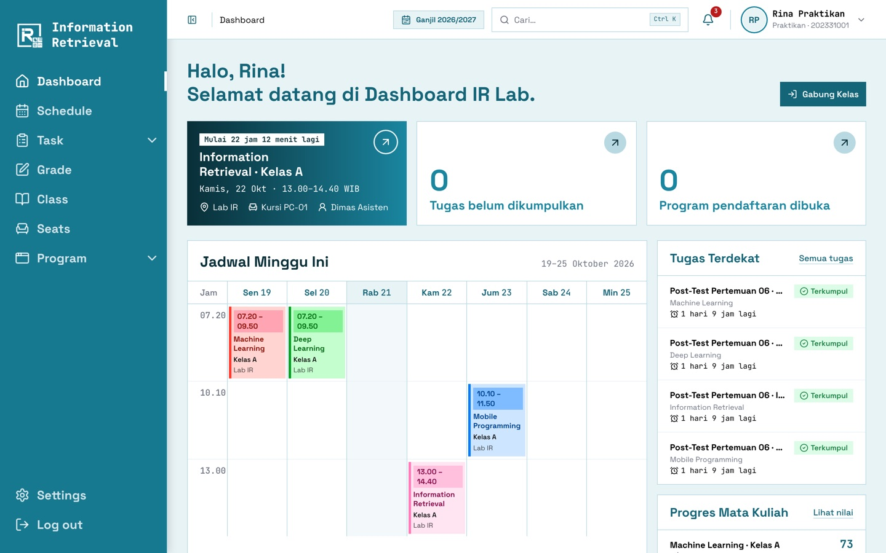
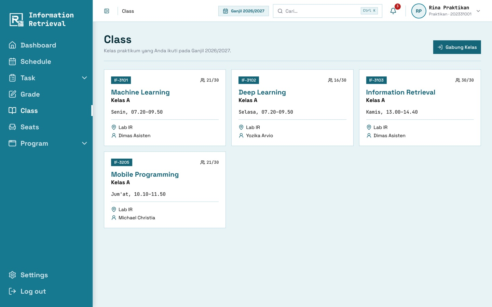
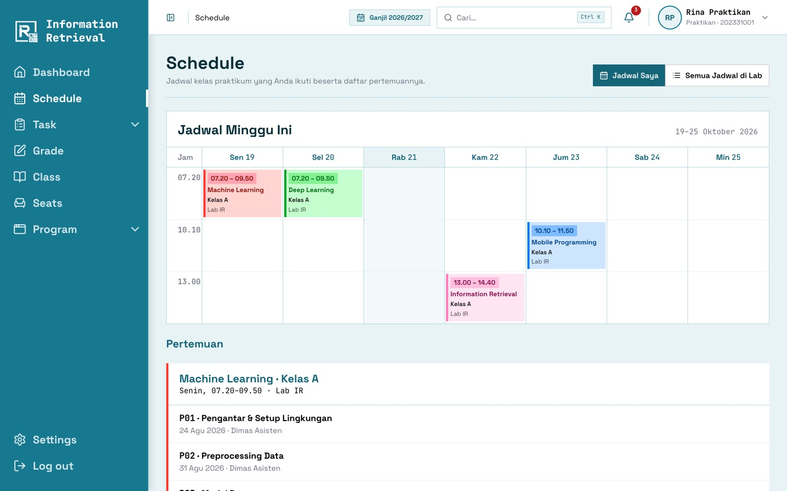
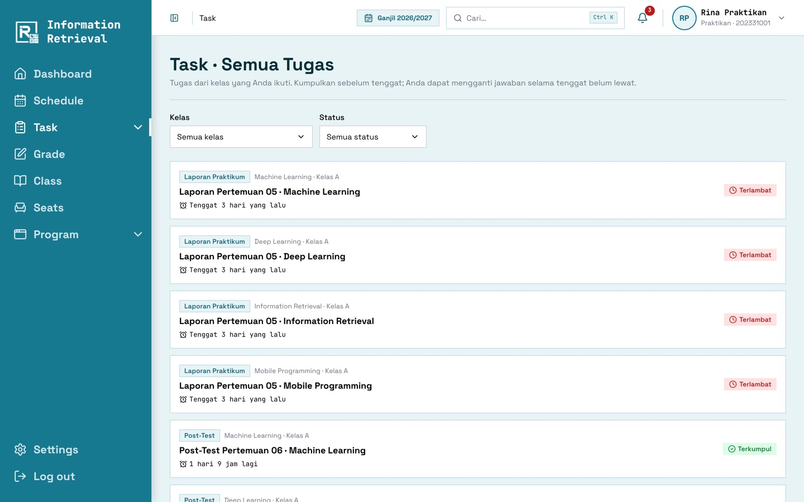
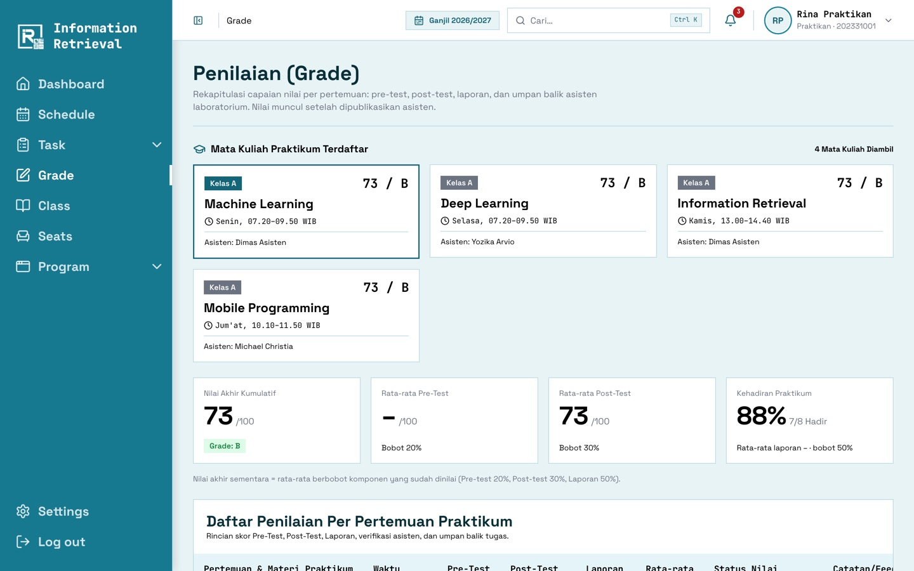
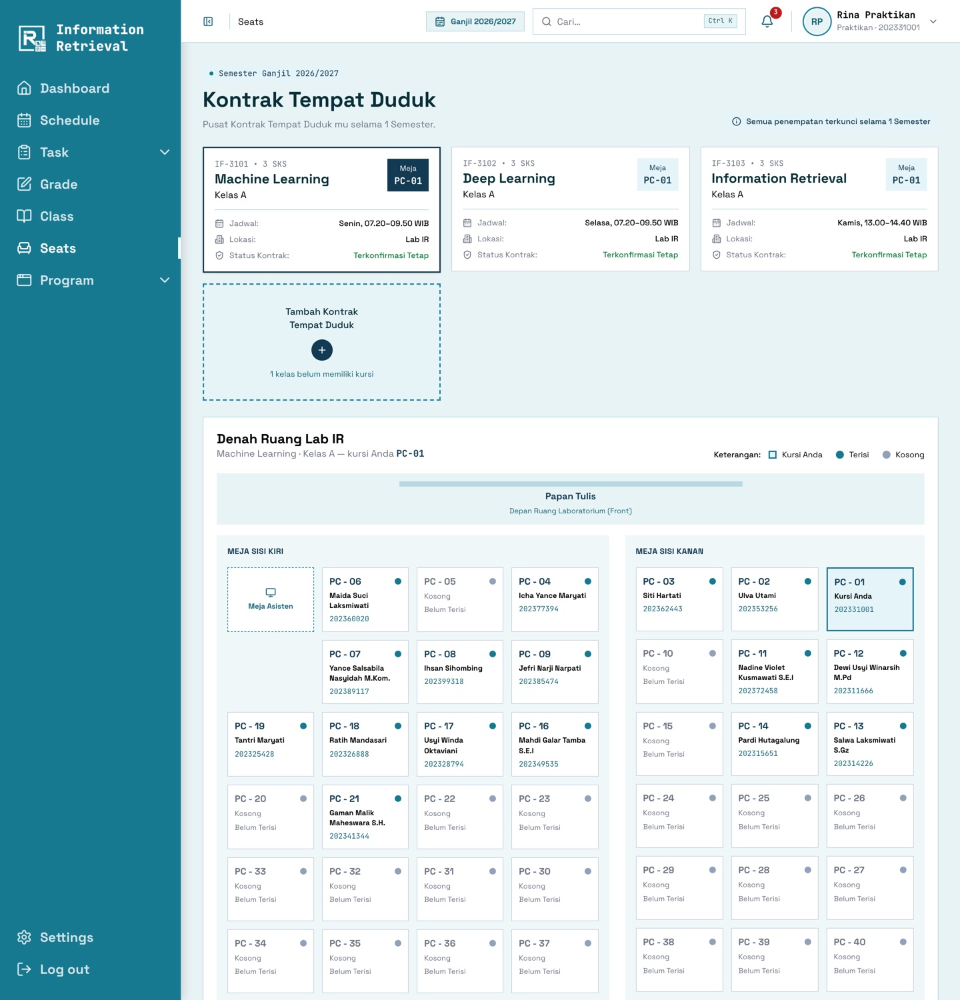

# Panduan Praktikan

[← Panduan pengguna](README.md)

## Dashboard

- **Kartu kelas berikutnya**: hitung mundur, ruang, nomor kursi, dan asisten.
- **Kelas Sedang Berlangsung**: saat sesi berjalan, Pre/Post-Test yang dibuka asisten langsung bisa
  dikerjakan dari sini.
- **Jadwal Minggu Ini**, **Tugas Terdekat**, **Progres Mata Kuliah** (nilai sementara), dan **Feedback**
  terbaru.

## 1. Bergabung ke kelas

1. Minta **token kelas** dari asisten (mis. `L7VQZJ`).
2. Klik **Gabung Kelas** (di dashboard atau menu _Class_), lalu masukkan token.
3. Kelas muncul di jadwal, dashboard, dan menu _Seats_.

> Satu mata kuliah hanya boleh satu kelas. Kelas yang terkunci atau penuh tidak bisa digabung.

## 2. Melihat jadwal

Menu **Schedule** menampilkan kalender mingguan dan daftar pertemuan beserta topiknya.

## 3. Mengerjakan tugas

1. Buka **Task**, lalu pilih tugas. Status ditandai _Terkumpul_, _Belum_, atau _Terlambat_.
2. Baca soal dan unduh lampirannya bila ada.
3. Unggah file sesuai format (PDF/ZIP/gambar) dan/atau tulis jawaban teks, lalu **Kumpulkan**.
4. Simpan **nomor tanda terima** (mis. `IRL-261021-000123`) sebagai bukti.
5. Selama tugas masih terbuka, Anda boleh mengirim ulang. Versi terbaru yang dinilai.

> **Pre-Test** hanya terbuka selama sesi kelas berjalan dan berlaku beberapa menit. Kerjakan dari panel
> _Kelas Sedang Berlangsung_ di dashboard.

## 4. Melihat nilai

Menu **Grade** menampilkan nilai per pertemuan (Pre-Test, Post-Test, Laporan), feedback asisten,
rata-rata komponen, kehadiran, dan **nilai akhir sementara** per mata kuliah. Hanya nilai yang sudah
dipublikasikan asisten yang tampil.

## 5. Memilih tempat duduk

1. Buka **Seats** lalu pilih **Tambah Kontrak Tempat Duduk** untuk kelas yang belum punya kursi.
2. Klik kursi kosong pada denah, lalu konfirmasi.
3. Kursi berlaku **satu semester** untuk kelas tersebut. Perubahan hanya bisa dilakukan Admin.
